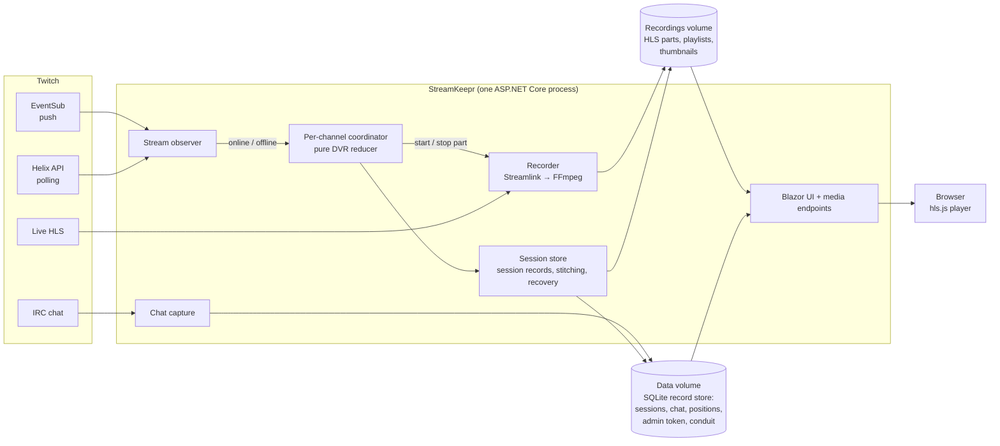

<p align="center">
  <picture>
    <source media="(prefers-color-scheme: dark)" srcset="branding/logo/streamkeepr-logo.svg">
    <source media="(prefers-color-scheme: light)" srcset="branding/logo/streamkeepr-logo-on-light.svg">
    
  </picture>
</p>

<p align="center">
  <strong>A self-hosted DVR for Twitch.</strong><br>
  Records the channels you watch to disk as HLS and plays them back, with chat, in your browser.
</p>

<p align="center">
  <a href="LICENSE">MIT License</a> ·
  <a href="SECURITY.md">Security and scope</a> ·
  <a href="deploy/README.md">Deploy with Docker</a> ·
  <a href="GLOSSARY.md">Glossary</a>
</p>

---

> [!WARNING]
> **Personal project, private home use only.** StreamKeepr is built for one operator on a trusted home network or LAN. It is not designed, tested, or supported for public hosting, multi-tenant use, or third-party distribution. The MIT license permits reuse, but the project comes with no warranty, no support commitment, and no security response process. Do not expose it to the public internet without your own hardening. See [`SECURITY.md`](SECURITY.md).

> [!IMPORTANT]
> **Not affiliated with Twitch.** StreamKeepr is an independent project and is not endorsed by, sponsored by, or affiliated with Twitch Interactive, Inc. "Twitch" and the Glitch logo are trademarks of Twitch Interactive, Inc. You are responsible for following Twitch's [Terms of Service](https://www.twitch.tv/p/legal/terms-of-service/), each creator's rights in their content, and the law where you live. Keep recordings for your own private viewing; do not redistribute them.

## Contents

- [Why StreamKeepr](#why-streamkeepr)
- [Features](#features)
- [How it works](#how-it-works)
- [Quick start with Docker](#quick-start-with-docker)
- [Running from source](#running-from-source)
- [Optional features](#optional-features)
- [Mock profile (no Twitch credentials)](#mock-profile-no-twitch-credentials)
- [Tests](#tests)
- [Compose deployment in detail](#compose-deployment-in-detail)
- [Container image](#container-image)
- [Project documentation](#project-documentation)
- [License](#license)

## Why StreamKeepr

Streams are live, and VODs on Twitch can expire, be muted, or be deleted. StreamKeepr watches a list of channels and, whenever one goes live, records the stream to your own disk. Afterward you browse and watch the recordings in a web UI that feels like a small personal VOD library, chat replay included.

It runs as one container on a home server or NAS: no cloud services and no external database.

## Features

**Recording**

- Watches any number of Twitch channels and starts recording automatically when one goes live, using Twitch EventSub push (WebSocket or Conduit) with Helix polling as a fallback.
- Records with Streamlink and FFmpeg to fragmented-MP4 HLS on disk, at the quality you choose (Streamlink's `best` by default).
- Recovers from interruptions: a dropped recorder starts a new *part* of the same session, retries back off with a cooldown, and unfinished sessions are repaired and finalized on the next start.
- Optional subscriber-only recording with your own Twitch login token.
- A disk guard stops recording before free space falls below a threshold (10 GB by default).
- Graceful shutdown finalizes active recordings within a fixed budget.

**Playback and library**

- A Blazor web UI with a library grouped by streamer: search, live/complete filters, and sorting.
- An hls.js player with live-edge following, a seamless switch from live to VOD when a stream ends, resume positions, saved volume and speed, and a stats overlay.
- Chapters built from title and game changes, plus thumbnails and recording details.
- Export any session as a single MP4 download.
- Delete complete recordings from the UI.

**Chat**

- Optional chat capture over Twitch IRC (anonymous read-only by default), replayed in sync with the video.
- Twitch emotes, global and channel chat badges, and optional BetterTTV, 7TV, and FrankerFaceZ emotes.
- Gaps from disconnects or dropped events are shown honestly, and deleted messages can be purged when a recording finalizes.

**Operations**

- Twitch sign-in for administration, with an optional login allowlist that makes the whole app private.
- A non-root multi-arch image (`linux/amd64`, `linux/arm64`) with health checks, Docker secrets, and log rotation.
- Structured JSON logs and optional OpenTelemetry metrics and traces, with a ready-made Grafana stack.
- A Mock profile that runs the whole app with fake channels and no Twitch credentials.

## How it works



- **One web project.** Everything runs in a single ASP.NET Core (.NET 11) app at [`src/StreamKeepr`](src/StreamKeepr): the recorder, Twitch integration, storage, and the Blazor Interactive Server UI built with MudBlazor.
- **A pure state machine per channel.** Each watched channel has its own coordinator that feeds events (live, offline, recorder exited, timer fired) into a pure reducer ([`Domain/DvrReducer.cs`](src/StreamKeepr/Domain/DvrReducer.cs)). The reducer returns commands, and the coordinator runs them one at a time. States are `Idle`, `Recording`, `WaitingToRetry`, `CoolingDown`, and `Paused`.
- **Sessions and parts.** A *session* is one continuous recording of a stream. Each recorder run writes one *part*: Streamlink pipes the stream into FFmpeg, which writes a part playlist and fMP4 segments. While a stream is live, the app serves a stitched *live index*; when it ends, the parts are stitched into one *session index* closed with `#EXT-X-ENDLIST`.
- **Storage.** Media (parts, playlists, thumbnails) lives under the recordings root; logs go under its private `.streamkeepr/` folder, which the media endpoint never serves. Durable records (channels, sessions, chat, viewer samples, resume positions, the encrypted admin token, and EventSub conduit state) live in one SQLite database on the data volume (ADR-0014), with the Data Protection keys beside it in `keys/`.
- **Twitch.** An app access token drives Helix lookups and EventSub; Twitch OAuth signs in the administrator. Push-aware polling keeps coverage when EventSub is unavailable.

The terms above are defined in [`GLOSSARY.md`](GLOSSARY.md). The binding design lives in the contracts under [`docs/`](docs) and the decisions in [`docs/adr/`](docs/adr); [`docs/decision-digest.md`](docs/decision-digest.md) is the entry point.

## Quick start with Docker

You need Docker with Compose and a Twitch application.

### 1. Register a Twitch application

In the [Twitch developer console](https://dev.twitch.tv/console/apps), register an application with the category **Application Integration** and an OAuth redirect URL of `http://localhost:8080/signin-twitch` (or your HTTPS proxy address followed by `/signin-twitch`). Copy the **Client ID** and create a **Client Secret**.

### 2a. Run the published image (no source needed)

The [`deploy/`](deploy/README.md) folder is a self-contained Compose setup for `ghcr.io/brandtkstrom/streamkeepr`. Copy it to your host, then:

```bash
cd deploy
cp secrets/twitch_client_id.txt.example     secrets/twitch_client_id.txt
cp secrets/twitch_client_secret.txt.example secrets/twitch_client_secret.txt
# Put the client ID and secret in the two files, one value per file.
```

```bash
sudo chown 1654:1654 secrets/*.txt && sudo chmod 400 secrets/*.txt
```

```bash
docker compose up -d
```

Every setting is documented inline in [`deploy/compose.yaml`](deploy/compose.yaml), and [`deploy/README.md`](deploy/README.md) covers the allowlist, subscriber tokens, reverse proxies, and updates.

### 2b. Build from this repository

From the repository root:

```bash
cp secrets/twitch_client_id.txt.example     secrets/twitch_client_id.txt
cp secrets/twitch_client_secret.txt.example secrets/twitch_client_secret.txt
# Put the client ID and secret in the two files, one value per file.
```

```bash
sudo chown 1654:1654 secrets/*.txt && sudo chmod 400 secrets/*.txt
```

```bash
docker compose up --build --detach
```

### 3. Open the app

Open <http://localhost:8080>, sign in with Twitch, and add channels under **Settings**. `docker compose ps` shows the service as `healthy` once it has started. Viewing works over plain HTTP from your LAN; signing in from another machine needs HTTPS (see [HTTPS reverse proxy](#https-reverse-proxy)).

> [!TIP]
> If other people can reach the app, set `Auth__AllowedTwitchLogins__0` to your Twitch login. With an empty allowlist, any Twitch account that signs in is an admin, and startup logs a warning. With a non-empty list, the whole app, viewing included, requires an allowed sign-in.

## Running from source

Requirements:

- the [.NET 11 SDK](https://dotnet.microsoft.com/download);
- `ffmpeg` and `ffprobe` on `PATH`;
- [Streamlink](https://streamlink.github.io/) on `PATH` (the container image pins 8.6.3).

The app validates its configuration at startup, so it needs Twitch app credentials, a writable recordings root, and a writable folder for the record store (the SQLite database; it defaults to `/data/streamkeepr.db`). For local development, keep them in user secrets:

```bash
dotnet user-secrets --project src/StreamKeepr set "Twitch:ClientId" "<client-id>"
dotnet user-secrets --project src/StreamKeepr set "Twitch:ClientSecret" "<client-secret>"
dotnet user-secrets --project src/StreamKeepr set "Storage:RecordingsRoot" "$PWD/recordings"
dotnet user-secrets --project src/StreamKeepr set "Storage:DatabasePath" "$PWD/data/streamkeepr.db"
```

```bash
dotnet run --project src/StreamKeepr
```

Then open <http://localhost:5080>. Local runs use the `Development` profile, which logs at `Debug`.

## Optional features

### Chat capture

Chat capture is off by default. Set `Chat:Enabled=true` to read chat over Twitch IRC while a session records. It uses anonymous read-only access by default. To use a known identity instead, configure a dedicated user token with `chat:read`:

```bash
dotnet user-secrets --project src/StreamKeepr set "Chat:TwitchUserOAuthToken" "<oauth-token>"
dotnet user-secrets --project src/StreamKeepr set "Chat:TwitchLogin" "<twitch-login>"
```

Chat is a best-effort live tap, not a complete history: disconnects, dropped events, and a full log appear as gaps. `Chat:PurgeDeletedText=OnFinalize` opts in to physically removing deleted text when a recording finalizes; it is off by default. Third-party emotes are off by default too; enable them with `Chat:Emotes:Bttv:Enabled=true`, `Chat:Emotes:SevenTv:Enabled=true`, and `Chat:Emotes:Ffz:Enabled=true`. Chat failures never stop recording. The other `Chat:` settings are listed in [`docs/runtime-contract.md`](docs/runtime-contract.md).

### Telemetry

OpenTelemetry metrics and traces are off by default. To export them, set `Telemetry__Enabled=true` and point `OTEL_EXPORTER_OTLP_ENDPOINT` at a collector; the standard `OTEL_EXPORTER_OTLP_*` protocol, timeout, and header settings apply. Without an endpoint, the app starts with telemetry enabled but exports nothing and logs a warning.

- Traces cover ASP.NET Core, HttpClient, and one Twitch poll span.
- Metrics cover DVR state, recorder parts, polling, EventSub, chat drops, storage, and exports, plus the framework and runtime meters.
- Logs are not exported through OpenTelemetry; Serilog remains the only logging pipeline.
- The app filters the OAuth callback, media, Blazor WebSocket, and health paths, and never exports tokens, OAuth codes or state, chat text, or channel logins.

See [`docs/runtime-contract.md`](docs/runtime-contract.md) for the full contract.

For a ready-made backend, `compose.observability.yaml` adds an OpenTelemetry Collector, Prometheus, Loki, Tempo, and Grafana to the Compose deployment, with structured logs, health probes, metrics, and traces wired together and a provisioned dashboard. It needs a Grafana admin password in `secrets/grafana_admin_password.txt` (copy the `.example` file):

```bash
docker compose -f compose.yaml -f compose.observability.yaml up -d --build
```

See [`observability/README.md`](observability/README.md).

## Mock profile (no Twitch credentials)

The `Mock` launch profile runs the whole app without Twitch, OAuth, or production data. It is a development and E2E environment only: it registers a fake admin login, so never set `ASPNETCORE_ENVIRONMENT=Mock` on a production host.

```bash
dotnet run --project src/StreamKeepr --launch-profile Mock
# or: dotnet watch --project src/StreamKeepr --launch-profile Mock
```

Open <http://localhost:5187>. The profile starts four fake channels and eight recordings:

- finished VODs, including two-part sessions and thumbnails;
- chapters derived from title and game changes;
- a growing EVENT capture recorded through `tests/fixtures/fake-live-streamlink`.

`MockPoller` supplies deterministic observations, `MockEventSubClient` accepts test-controlled pushes, and the fake cookie auth signs in as `mock_admin` by default. None of these touch Twitch or construct the real HTTP or EventSub clients. The startup tool preflight still runs, so `ffmpeg` and `ffprobe` must be on `PATH`; Streamlink is always the committed fake fixture. On Windows that fixture runs through bash, so `bash.exe` (Git for Windows) must be on `PATH` or under `%ProgramFiles%\Git`.

Mock data lives under the system temp directory (`.../streamkeepr-mock/recordings`), is reset on each start, and is never read from user secrets. Each Mock process also gets its own record store under `.../streamkeepr-mock/records-<id>/`, deleted on a clean shutdown; its channels are re-seeded every start. Its Data Protection keys stay in one fixed folder, `.../streamkeepr-mock/keys`, so the Mock sign-in cookie survives a restart. `Mock:RecordingsRoot` must be a directory below the system temp directory; the host rejects any other path. A non-empty custom root without the mock-seeded marker is refused rather than deleted. To keep the previous run:

```bash
Mock__Seed__ResetOnStart=false dotnet run --project src/StreamKeepr --launch-profile Mock
```

### Fake auth toggle

The fake auth is signed in by default. To launch signed out for E2E or manual checks:

```bash
Mock__Auth__SignedIn=false dotnet run --project src/StreamKeepr --launch-profile Mock
```

The same setting can be changed in `appsettings.Mock.json` under `Mock:Auth:SignedIn`. Signed-out runs have no admin cookie; signing in through Twitch is not mapped in the Mock profile.

## Tests

```bash
dotnet build StreamKeepr.sln -warnaserror
dotnet format StreamKeepr.sln --verify-no-changes
dotnet test tests/StreamKeepr.Tests
dotnet test StreamKeepr.sln --filter "Category!=E2E"
```

`StreamKeepr.E2E` is the Playwright for .NET suite. It launches the Mock profile on `http://127.0.0.1:5187`, waits for `/health/ready`, runs branded Chrome, and checks the shell with axe. It needs ffmpeg and Google Chrome. Install the Playwright browser dependencies first:

```bash
dotnet build tests/StreamKeepr.E2E
pwsh tests/StreamKeepr.E2E/bin/Debug/net11.0/playwright.ps1 install --with-deps chrome
dotnet test tests/StreamKeepr.E2E
```

Every test records a Playwright trace. A passing test discards it; a failed test writes the trace with a `<test>.failure.txt` (browser state and the last Mock app log lines). Screenshots, axe results, a small `report.html` index, and the Mock app log are written to a unique directory under the system temp directory. Set `STREAMKEEPR_E2E_ARTIFACTS` to keep them at a known path; CI sets it and uploads the directory as `playwright-results`. E2E has no automatic retries; a failure is fixed or quarantined explicitly.

## Compose deployment in detail

The repository's own `compose.yaml` builds the non-root image (UID 1654) and runs one `stream-keepr` service with Streamlink and static FFmpeg/ffprobe inside. It publishes plain HTTP on port 8080, stores recordings on a named volume, enables `init`, inherits the image's `/health/live` healthcheck, rotates Docker logs, and gives shutdown a 50 s grace period. To run a released image without the source, use [`deploy/`](deploy/README.md) instead.

### Secret files and permissions

Create the secret files from the checked-in examples, from the repository root:

```bash
cp secrets/twitch_client_id.txt.example secrets/twitch_client_id.txt
cp secrets/twitch_client_secret.txt.example secrets/twitch_client_secret.txt
# Edit both files and replace the placeholders.
```

Docker Compose mounts these files into `/run/secrets`. That is a bind mount on Linux, so the container process (UID 1654) must be able to read the host files. Make UID 1654 the owner and remove group and other access:

```bash
sudo chown 1654:1654 secrets/twitch_client_id.txt secrets/twitch_client_secret.txt
sudo chmod 400 secrets/twitch_client_id.txt secrets/twitch_client_secret.txt
```

Mode `600` with owner `1654:1654` also works. Do not make real secrets world-readable or add them to the image, and never commit them. On macOS Docker Desktop, file ownership is mapped by the VM; the `chown` is harmless but usually unnecessary.

`secrets/.gitignore` keeps the `*.example` files and ignores the real files.

Start the service:

```bash
docker compose up --build --detach
docker compose logs --follow stream-keepr
```

Open <http://localhost:8080>. The image runs as UID 1654, reads recordings from `/recordings`, and keeps the record store (channels and other app records) in `/data/streamkeepr.db`.

The service reads secret files from `/run/secrets`; `AddKeyPerFile` maps `__` in a file name to `:` in the configuration key, so `Twitch__ClientId` becomes `Twitch:ClientId`. The secrets are not environment variables and are never baked into the image. To use a subscriber-only Streamlink token, create `secrets/recorder_twitch_user_oauth_token.txt`, apply the same ownership and mode, and uncomment both `Recorder__TwitchUserOAuthToken` entries in `compose.yaml`.

To seed the first channel on a fresh deployment, uncomment `Twitch__Channels__0` in `compose.yaml` and set it to a Twitch login, or leave `${TWITCH_CHANNEL_LOGIN}` and set that variable in `.env`. Do not leave an empty value: an empty login fails options validation. The seeded login is only used when the persisted channel list is first created; later changes are made through the application's channel controls.

### Volume ownership

Named volumes inherit the image's ownership of `/recordings` and `/data`. To use host folders instead, replace the volumes with `- ./recordings:/recordings` and `- ./data:/data` and run:

```bash
sudo chown -R 1654:1654 ./recordings ./data
```

The startup preflight fails with this instruction when either folder is not writable, and when the data volume has less than `Storage:DatabaseMinFreeGb` (default 1 GB) free.

### HTTPS reverse proxy

Sign-in requires HTTPS except on `localhost`, so plain port 8080 is for viewing and local administration only. Put a TLS-terminating reverse proxy in front of the service and trust only that proxy (or its network):

```json
"Hosting": {
  "ForwardedHeaders": {
    "KnownProxies": ["10.0.0.2"],
    "KnownNetworks": ["10.0.0.0/24"]
  }
}
```

Both lists default to empty, which ignores every `X-Forwarded-*` header. An app behind an unconfigured proxy refuses sign-in with `authError=httpsRequired` instead of sending Twitch a broken callback.

### Stop, restart, and logs

`docker compose stop` sends SIGTERM through `init` to the app. Active recordings finalize within the host's 40 s shutdown budget, below Compose's 50 s grace period. `docker compose restart` (or `start`) recovers unfinished sessions on the next launch. Data Protection keys live under `/data/keys`, beside the record store that holds the encrypted admin token, so sign-in cookies and the token survive a restart. `docker compose down` keeps both volumes; `docker compose down --volumes` deletes recordings, keys, and the record store. Back up both volumes together. Before an upgrade migrates the record store, the app writes a backup to `/data/backups` (the three newest are kept); a damaged database, or one from a newer version, stops startup with an error naming the file and is never reset.

Docker log rotation is capped at 10 MB per file with five files. The app also writes the same events as compact JSON to `<recordings>/.streamkeepr/logs/`: daily files, 50 MB each, seven kept, so they can take up to roughly 350 MB of the recordings volume. Set `Serilog__File__Enabled=false` to turn them off. Production logs at `Information` unless you change it.

### Compose smoke test

The smoke test builds an isolated image and first checks the production contract: health, non-root UID, ownership of the separate `/recordings` and `/data` volumes, the record store on `/data`, secret availability as UID 1654, log rotation, clean stop, and restart. It then starts the test-only Mock override with `./tests/fixtures` mounted read-only, records the growing Mock capture through the fake Streamlink, stops the service, and verifies every part playlist has exactly one `ENDLIST`. It restarts the same container to prove the `sk-auth` cookie and Data Protection keys survive, a seeded deep link still renders, and the stopped process deleted its Mock record store.

```bash
./scripts/compose-smoke.sh
```

The smoke test uses a unique Compose project, container, image tag, and temporary secret directory. It never touches an operator's stack, recordings, or secrets.

## Container image

The image can also be run directly. A named volume inherits the image's ownership; a bind mount needs the `chown` above. Mount secret files rather than passing credentials in `docker run --env` arguments:

```bash
docker build -t streamkeepr .
docker run --rm -p 8080:8080 \
  -v streamkeepr-recordings:/recordings \
  -v streamkeepr-data:/data \
  --mount type=bind,source="$PWD/secrets/twitch_client_id.txt",target=/run/secrets/Twitch__ClientId,readonly \
  --mount type=bind,source="$PWD/secrets/twitch_client_secret.txt",target=/run/secrets/Twitch__ClientSecret,readonly \
  streamkeepr
```

The two files must have the ownership and mode described above. Streamlink is pinned at 8.6.3 and can be bumped with `--build-arg STREAMLINK_VERSION=<version>`.

## Project documentation

| Document | What it covers |
| --- | --- |
| [`GLOSSARY.md`](GLOSSARY.md) | The domain vocabulary: session, part, live index, and so on |
| [`docs/decision-digest.md`](docs/decision-digest.md) | Entry point to every design decision and contract |
| [`docs/adr/`](docs/adr) | Architecture decision records |
| [`docs/domain-model.md`](docs/domain-model.md), [`docs/recorder-contract.md`](docs/recorder-contract.md), [`docs/session-store-contract.md`](docs/session-store-contract.md) | The DVR reducer, recorder processes, and session storage |
| [`docs/runtime-contract.md`](docs/runtime-contract.md), [`docs/hosting-contract.md`](docs/hosting-contract.md), [`docs/twitch-auth-contract.md`](docs/twitch-auth-contract.md) | Runtime settings, hosting and media security, Twitch and auth |
| [`docs/testing-contract.md`](docs/testing-contract.md) | Test layers, the fake harness, and CI gates |
| [`deploy/README.md`](deploy/README.md) | Running the published image with Compose |
| [`observability/README.md`](observability/README.md) | The optional Grafana stack |
| [`branding/`](branding) | Logo, mark, and favicon set, with usage rules |

## License

StreamKeepr is released under the [MIT License](LICENSE) and is provided "as is", without warranty of any kind. The StreamKeepr logo and icons in [`branding/`](branding) are original project artwork. Bundled third-party assets keep their own licenses; see [`docs/design-assets.md`](docs/design-assets.md).
