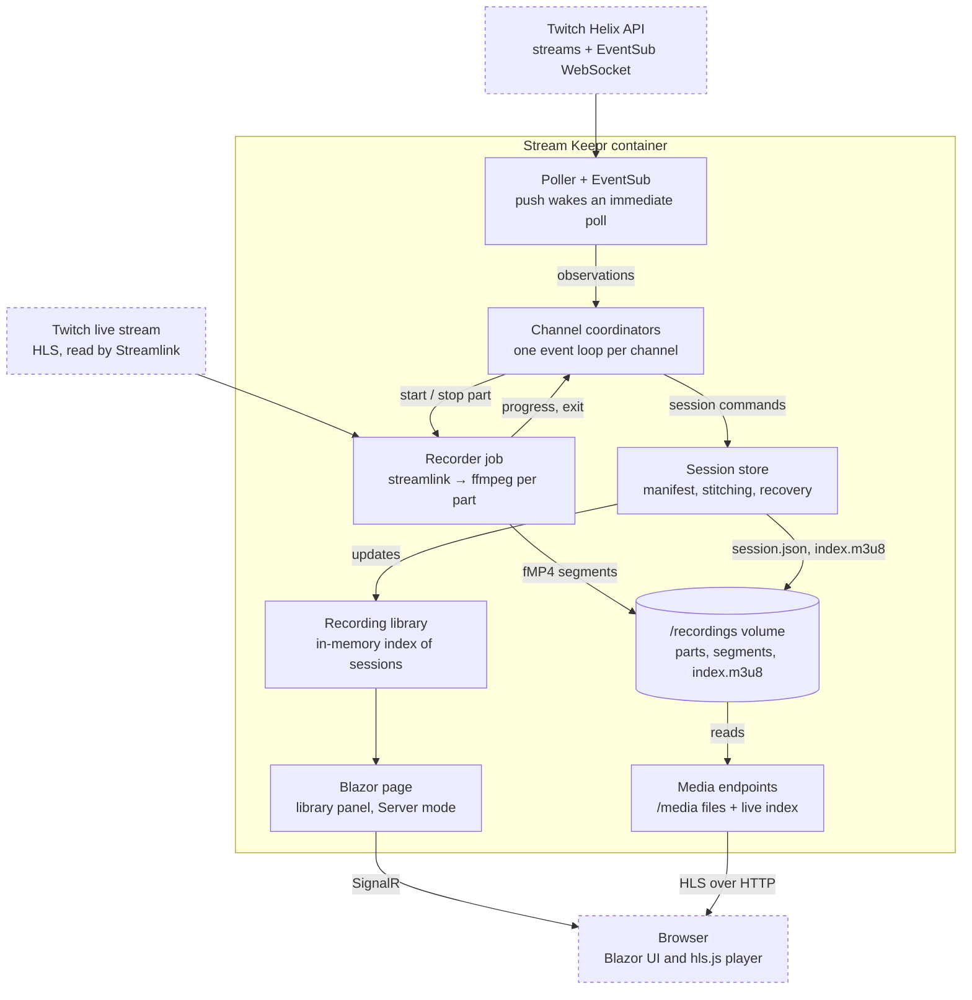
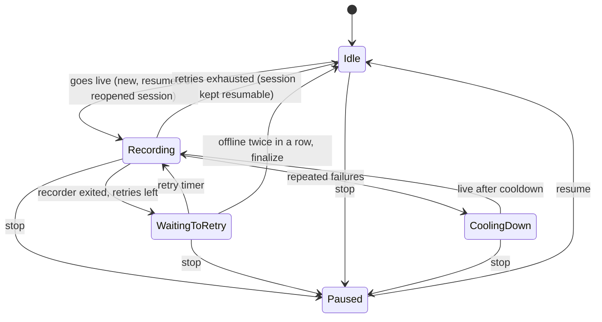

# Stream Keepr — Final Implementation Plan

Stream Keepr is a self-hosted Twitch DVR: it records Twitch channels with Streamlink and FFmpeg into HLS (fMP4) on disk and plays them back in a Blazor web app with a YouTube-style player, all in one Docker container.

- **Part 1** is the system plan: domain model and reducer, configuration, Twitch polling and EventSub, the recorder, session storage and recovery, the supervisor, hosting and containerization, tests and decisions.
- **Part 2** is the frontend plan: 63 agent-sized tasks across 11 feature areas plus backend additions, built on the Stream Keepr design system.

---

# Part 1 — Stream Keepr implementation plan (v3)

Nov 9, 2026 · @Brandt

## Overview

Stream Keepr records a list of Twitch channels to disk as HLS with fMP4 segments and plays recordings back in a Blazor page with a YouTube-style player, all from one Docker container. This v3 folds in the v2 review: Blazor replaces Nginx, the state machine is a real discriminated union, and every interruption ends in a known state instead of a stuck or split recording.

**Goals**

- **Efficient:** stream copy only (no transcoding), no directory polling, an in-memory library index, one container.
- **Fault tolerant:** network drops, process crashes and container restarts leave one continuous recording, and every failure path ends in a known state.
- **Containerized:** one non-root image; stopping the container finalizes playlists.

**Stack:** .NET 10, C# 14, ASP.NET Core with Blazor (Interactive Server), CliWrap, Streamlink, FFmpeg, hls.js.

### Changes from v2

| Area | v2 | v3 |
| --- | --- | --- |
| UI and serving | Nginx container and a static `player.html` | Blazor page in the app; recordings served by the app at `/media` |
| State model | Flat record with `string Status` and nullable fields | Closed record hierarchy; transitions return a list of commands |
| Retries | New folder per retry | Same session, new part, stitched `index.m3u8` |
| Restarts | No recovery | Startup scan resumes or finalizes unfinished sessions |
| Shutdown | `q\n` written into the video pipe; job not awaited | stdin EOF, then SIGINT, then kill, awaited within the shutdown timeout |
| Job failures | Fire-and-forget; state could stick at Recording | Every job ends with a terminal event; events carry a `JobId` |
| Polling | Only while Idle | Every tick; drives resume, finalize and new-session decisions |
| Progress | Directory scan every 3 s | FFmpeg `-progress` output plus a stall watchdog |
| Titles | In folder names and URLs | Stored in `session.json`; folders use start time and stream ID |
| Container | Two services, no `.dockerignore`, apt FFmpeg | One service, `.dockerignore`, static FFmpeg, `init`, log rotation |

v2 also set `BoundedChannelOptions.SingleConsumer`, which doesn't exist (the property is `SingleReader`). v3 uses an unbounded channel instead; Phase 6 explains why.

## Architecture

Stream Keepr is one ASP.NET Core process. Only the coordinator changes state: the poller and recorder report to it as events, the session store writes what it decides, and the UI only reads the library and the recordings volume.



*Every decision flows through a channel coordinator. Dashed boxes sit outside the container.*

Dashed boxes sit outside the container. Every arrow into the coordinator is an event on its channel; every arrow out of it is a command from the reducer.

## Project structure

One web project holds the domain, infrastructure, hosting and Blazor UI; tests live beside it. Player styles go in a global stylesheet rather than Blazor CSS isolation, because the player's JavaScript creates menu elements that isolated CSS can't reach.

```text
StreamKeepr/
├── src/StreamKeepr/
│   ├── Domain/
│   │   ├── Models.cs                 # LiveStream, Session, JobId, Resumable
│   │   ├── DvrState.cs               # Closed state hierarchy
│   │   ├── DvrEvent.cs               # Events + StreamObservation
│   │   ├── DvrCommand.cs
│   │   └── DvrReducer.cs             # Pure Transition(state, event, settings)
│   ├── Configuration/
│   │   ├── TwitchOptions.cs
│   │   ├── RecorderOptions.cs
│   │   ├── StorageOptions.cs
│   │   └── DvrSettingsFactory.cs     # Builds Domain.DvrSettings from options
│   ├── Infrastructure/
│   │   ├── Twitch/                   # TwitchTokenProvider, TwitchStreamPoller, HelixModels,
│   │   │                             # PollSchedule, EventSubClient, AdminTokenStore
│   │   ├── Media/                    # RecorderJob, FfmpegArgs, StreamlinkArgs,
│   │   │                             # FfmpegProgressParser, StderrTail
│   │   ├── Storage/                  # SessionStore, PlaylistStitcher, RecoveryService,
│   │   │                             # RecordingLibrary, DiskGuard, ChannelStore
│   │   └── Runtime/                  # DvrSupervisor, ChannelCoordinator, DvrStatus
│   ├── Hosting/                      # DvrHealthCheck, DiskSpaceHealthCheck,
│   │                                 # ToolPreflight, RecordingsMedia
│   ├── Components/
│   │   ├── App.razor, Routes.razor, Layout/ (AppShell, TopAppBar)
│   │   ├── Pages/Home.razor
│   │   ├── Primitives/ (design-system components)
│   │   └── Features/ (Library, Player, Stats, Details, Auth, Search)  # Full layout: Part 2
│   ├── wwwroot/
│   │   ├── css/ (design-system tokens and components), fonts/, js/
│   │   └── lib/hls.js/hls.mjs        # Self-hosted, pinned
│   ├── Program.cs
│   ├── appsettings.json
│   └── StreamKeepr.csproj
├── tests/StreamKeepr.Tests/          # Reducer, stitcher, parser, recovery tests
├── secrets/                          # Git- and Docker-ignored
├── Dockerfile
├── .dockerignore
└── compose.yaml
```

**On-disk layout.** The folder name uses the Helix start time and stream ID only, so it is always a safe path segment and URL. Titles, games and status live in `session.json`.

```text
/recordings/
├── .streamkeepr/           # channels.json, progress, exports, keys (never served)
└── {channel}/
    └── 20261109T180312Z_316928423/
        ├── session.json        # Manifest: status, title/game history
        ├── index.m3u8          # Stitched playlist, written at finalize
        ├── thumb.jpg
        ├── p001.m3u8  init_001.mp4  p001_00000.m4s ...
        └── p002.m3u8  init_002.mp4  p002_00000.m4s ...
```

## Phase 1: Domain

The domain is a pure reducer over closed record hierarchies. `Transition(state, event, settings)` returns the next state and a list of commands, and never touches clocks, randomness, threads or I/O; every time and ID arrives on an event or in settings.



*DVR states and transitions. Retries stay in one session; offline or stop finalizes it, and the same stream returning reopens it.*

After retries are exhausted, Idle keeps the session resumable: the same stream ID going live again resumes it, and Offline finalizes it. A new stream ID while recording closes the old session and opens a new one; a title or game change only writes metadata. Stop works from every state: it finalizes any open session and parks the channel in Paused until resume. Each channel runs its own copy of this machine (Phase 6).

### Models (`Domain/Models.cs`)

```csharp
namespace StreamKeepr.Domain;

public sealed record LiveStream(
    string StreamId, string Title, string Game, DateTimeOffset StartedAt, string? ThumbnailUrl);

public sealed record Session(
    string Id, string Channel, string StreamId, DateTimeOffset StartedAt, string Directory)
{
    // Channel is validated as a Twitch login and StreamId as digits, so Id is a safe path segment.
    public static Session For(LiveStream live, string channel, string recordingsRoot)
    {
        string id = $"{live.StartedAt.UtcDateTime:yyyyMMdd'T'HHmmss'Z'}_{live.StreamId}";
        return new(id, channel, live.StreamId, live.StartedAt, Path.Combine(recordingsRoot, channel, id));
    }
}

// One recorder run = one part of one session. Deterministic, so the reducer needs no Guid source.
public readonly record struct JobId(string SessionId, int Part)
{
    public override string ToString() => $"{SessionId}/p{Part:D3}";
}

public sealed record Resumable(Session Session, int NextPart);

public sealed record DvrSettings(
    string RecordingsRoot,
    string Channel,
    int MaxRetries,
    TimeSpan RetryBase,
    TimeSpan RetryMax,
    int FailuresBeforeCooldown,
    TimeSpan Cooldown);
```

### State, events and commands

Each base record has a private constructor, so only the nested types can derive from it and no other file can add a case. The v2 `extension` block that compared status strings is gone; checks become `state is DvrState.Idle`.

```csharp
using System.Collections.Immutable;

namespace StreamKeepr.Domain;

public abstract record DvrState
{
    private DvrState() { }

    // Nothing recording. Resume holds an unfinished session that Helix may still report live.
    // Finished holds this channel's last finalized session, reopened if the same stream comes back.
    public sealed record Idle(Resumable? Resume = null, int Streak = 0, Resumable? Finished = null) : DvrState;

    public sealed record Recording(
        Session Session, JobId Job, LiveStream Latest, int Attempt, bool HasMedia, int Streak) : DvrState;

    public sealed record WaitingToRetry(
        Session Session, JobId Next, LiveStream Latest, int Attempt, int Streak,
        int OfflineCount = 0) : DvrState;   // Consecutive Offline polls while waiting

    // Repeated sessions failed without media (e.g. Streamlink broken). Live is ignored until Until.
    public sealed record CoolingDown(DateTimeOffset Until, Resumable? Resume, string LastError) : DvrState;

    // Stopped from the UI: live observations are ignored until ResumeRequested. Persisted per channel.
    public sealed record Paused(Resumable? Finished = null) : DvrState;
}

public abstract record StreamObservation
{
    private StreamObservation() { }
    public sealed record Live(LiveStream Stream) : StreamObservation;
    public sealed record Offline : StreamObservation;
    public sealed record Unknown(string Error) : StreamObservation;   // API error: never treated as offline
}

public abstract record DvrEvent
{
    private DvrEvent() { }
    public sealed record StreamStatusObserved(StreamObservation Observation, DateTimeOffset At) : DvrEvent;
    public sealed record SessionRecovered(Resumable Resume) : DvrEvent;
    public sealed record PartProducingMedia(JobId Job) : DvrEvent;   // sent once per part
    public sealed record RecorderExited(JobId Job, DateTimeOffset At, string Detail) : DvrEvent;
    public sealed record RetryTimerElapsed(JobId Job) : DvrEvent;
    public sealed record StopRequested : DvrEvent;     // From the UI, signed-in only
    public sealed record ResumeRequested : DvrEvent;
}

public abstract record DvrCommand
{
    private DvrCommand() { }
    public sealed record OpenSession(Session Session, LiveStream Stream) : DvrCommand;
    public sealed record ReopenSession(Session Session) : DvrCommand;   // Back to Recording; every part kept
    public sealed record RecordMetadata(Session Session, LiveStream Stream) : DvrCommand;
    public sealed record StartRecorder(Session Session, JobId Job) : DvrCommand;
    public sealed record StopRecorder(JobId Job) : DvrCommand;
    public sealed record ScheduleRetry(JobId Job, TimeSpan BaseDelay) : DvrCommand;
    public sealed record FinalizeSession(Session Session) : DvrCommand;
}

public readonly record struct Step(DvrState Next, ImmutableArray<DvrCommand> Commands);
```

Byte counts, media time and heartbeats are telemetry, not control state. They go to `DvrStatus` (Phase 6), so the reducer sees one media event per part instead of one every few seconds.

### Reducer (`Domain/DvrReducer.cs`)

```csharp
using System.Diagnostics;
using static StreamKeepr.Domain.DvrCommand;
using static StreamKeepr.Domain.DvrEvent;
using static StreamKeepr.Domain.DvrState;
using static StreamKeepr.Domain.StreamObservation;

namespace StreamKeepr.Domain;

public static class DvrReducer
{
    public static Step Transition(DvrState state, DvrEvent evt, DvrSettings s) => (state, evt) switch
    {
        (Idle idle, SessionRecovered(var resume)) => Stay(idle with { Resume = resume }),

        (Idle idle, StreamStatusObserved(var obs, _)) => FromIdle(idle, obs, s),

        (CoolingDown cool, StreamStatusObserved(var obs, var at)) when at >= cool.Until =>
            FromIdle(new Idle(cool.Resume, Streak: 0), obs, s),

        (CoolingDown { Resume: { } r } cool, StreamStatusObserved(Offline, _)) =>
            Do(cool with { Resume = null }, new FinalizeSession(r.Session)),

        (Recording rec, PartProducingMedia(var job)) when job == rec.Job && !rec.HasMedia =>
            Stay(rec with { HasMedia = true, Attempt = 0, Streak = 0 }),

        (Recording rec, RecorderExited(var job, var at, var detail)) when job == rec.Job =>
            AfterExit(rec, at, detail, s),

        (WaitingToRetry wait, RetryTimerElapsed(var job)) when job == wait.Next =>
            Do(new Recording(wait.Session, wait.Next, wait.Latest, wait.Attempt, HasMedia: false, wait.Streak),
               new StartRecorder(wait.Session, wait.Next)),

        (WaitingToRetry { OfflineCount: >= 1 } wait, StreamStatusObserved(Offline, _)) =>
            Do(new Idle(Resume: null, wait.Streak, Finished: new Resumable(wait.Session, wait.Next.Part)),
               new FinalizeSession(wait.Session)),

        // One Offline poll can be a Helix blip: finalize only on the second in a row.
        (WaitingToRetry wait, StreamStatusObserved(Offline, _)) => Stay(wait with { OfflineCount = 1 }),

        (Recording or WaitingToRetry, StreamStatusObserved(Live(var live), _)) => WhileActive(state, live, s),

        // Stop works from every state: finalize whatever is open, then ignore Live until resume.
        (Recording rec, StopRequested) =>
            Do(new Paused(new Resumable(rec.Session, rec.Job.Part + 1)), new StopRecorder(rec.Job),
               new FinalizeSession(rec.Session)),

        (WaitingToRetry wait, StopRequested) => Do(new Paused(new Resumable(wait.Session, wait.Next.Part)), new FinalizeSession(wait.Session)),

        (Idle { Resume: { } r }, StopRequested) => Do(new Paused(r), new FinalizeSession(r.Session)),

        (CoolingDown { Resume: { } r }, StopRequested) => Do(new Paused(r), new FinalizeSession(r.Session)),

        (Idle idle, StopRequested) => Stay(new Paused(idle.Finished)),

        (CoolingDown, StopRequested) => Stay(new Paused()),

        (Paused paused, ResumeRequested) => Stay(new Idle(Finished: paused.Finished)),   // The next observation decides whether to record

        // Stale job events, Unknown observations, anything while Paused: no change.
        _ => Stay(state),
    };

    private static Step FromIdle(Idle idle, StreamObservation obs, DvrSettings s) => obs switch
    {
        // The same stream back after a stop or an offline blip: reopen its session as the next part.
        Live(var live) when idle.Finished is { } f && f.Session.StreamId == live.StreamId =>
            StartPart(f.Session, f.NextPart, live, idle.Streak,
                new ReopenSession(f.Session), new RecordMetadata(f.Session, live)),

        Live(var live) when idle.Resume is { } r && r.Session.StreamId == live.StreamId =>
            StartPart(r.Session, r.NextPart, live, idle.Streak, new RecordMetadata(r.Session, live)),

        Live(var live) when idle.Resume is { } r =>
            StartSession(live, idle.Streak, s, new FinalizeSession(r.Session)),

        Live(var live) => StartSession(live, idle.Streak, s),

        Offline when idle.Resume is { } r =>
            Do(idle with { Resume = null, Finished = r }, new FinalizeSession(r.Session)),

        _ => Stay(idle),
    };

    private static Step WhileActive(DvrState state, LiveStream live, DvrSettings s)
    {
        var (session, latest, streak) = state switch
        {
            Recording r => (r.Session, r.Latest, r.Streak),
            WaitingToRetry w => (w.Session, w.Latest, w.Streak),
            _ => throw new UnreachableException(),
        };
        if (state is WaitingToRetry { OfflineCount: > 0 } blip) state = blip with { OfflineCount = 0 };   // Live again

        if (live.StreamId != session.StreamId)   // Streamer restarted: close this session, open a new one.
            return state is Recording rec
                ? StartSession(live, streak, s, new StopRecorder(rec.Job), new FinalizeSession(session))
                : StartSession(live, streak, s, new FinalizeSession(session));

        if (live.Title == latest.Title && live.Game == latest.Game
            && (latest.ThumbnailUrl is not null || live.ThumbnailUrl is null))
            return Stay(state);

        DvrState updated = state switch
        {
            Recording r => r with { Latest = live },
            WaitingToRetry w => w with { Latest = live },
            _ => state,
        };
        return Do(updated, new RecordMetadata(session, live));
    }

    private static Step AfterExit(Recording rec, DateTimeOffset at, string detail, DvrSettings s)
    {
        int attempt = rec.HasMedia ? 1 : rec.Attempt + 1;
        int nextPart = rec.Job.Part + 1;

        if (attempt <= s.MaxRetries)
        {
            var next = new JobId(rec.Session.Id, nextPart);
            return Do(new WaitingToRetry(rec.Session, next, rec.Latest, attempt, rec.Streak),
                      new ScheduleRetry(next, Backoff(attempt, s)));
        }

        // Retries exhausted: keep the session resumable and let Helix decide resume vs. finalize.
        var resume = new Resumable(rec.Session, nextPart);
        int streak = rec.Streak + 1;
        return streak >= s.FailuresBeforeCooldown
            ? Stay(new CoolingDown(at + s.Cooldown, resume, detail))
            : Stay(new Idle(resume, streak));
    }

    private static Step StartSession(LiveStream live, int streak, DvrSettings s, params DvrCommand[] before)
    {
        var session = Session.For(live, s.Channel, s.RecordingsRoot);
        return StartPart(session, part: 1, live, streak, [.. before, new OpenSession(session, live)]);
    }

    private static Step StartPart(Session session, int part, LiveStream live, int streak, params DvrCommand[] before)
    {
        var job = new JobId(session.Id, part);
        return new(new Recording(session, job, live, Attempt: 0, HasMedia: false, streak),
                   [.. before, new StartRecorder(session, job)]);
    }

    // 2 s, 4 s, 8 s ... capped at RetryMax. The coordinator adds ±25 % jitter when it schedules the timer.
    private static TimeSpan Backoff(int attempt, DvrSettings s) =>
        TimeSpan.FromTicks(Math.Min(s.RetryMax.Ticks, s.RetryBase.Ticks << Math.Min(attempt - 1, 16)));

    private static Step Stay(DvrState state) => new(state, []);
    private static Step Do(DvrState state, params DvrCommand[] commands) => new(state, [.. commands]);
}
```

**Behavior that matters for fault tolerance**

- **Retries never create a new session.** Each retry is a new part (`p002`, `p003`). The recorder deletes a part that produced no media, so part numbers can skip.
- **Exhausted retries don't finalize.** The session stays resumable and Helix decides: the same stream ID live means resume, offline means finalize. This also absorbs Helix reporting "live" for a while after a stream ends.
- **`Streak` stops runaway loops.** It counts sessions that exhausted retries since media last flowed; reaching `FailuresBeforeCooldown` enters CoolingDown instead of creating empty folders every minute.
- **Stale events can't move the wrong session.** Every job event carries its `JobId`, and arms match only the current one, so a cancelled recorder or a late timer falls through to no change.

* **Stop finalizes; the same stream reopens.** A stopped stream is finalized as it stands. If it is still live after resume, or returns after an offline blip, its session is reopened as the next part: one recording, and nothing already written is ever overwritten. Recovery restores this memory after a restart.

## Phase 2: Configuration and secrets

Settings split into three validated options classes, and startup fails fast if a secret or setting is missing or malformed. v2 relied on the `required` keyword, which the configuration binder ignores; v3 uses `[Required]` with empty defaults so validation catches missing values.

### Options (`Configuration/`)

C# 14's `field` keyword trims values in the setter, which strips the trailing newline Docker secret files usually carry.

```csharp
using System.ComponentModel.DataAnnotations;

namespace StreamKeepr.Configuration;

public sealed class TwitchOptions
{
    public const string SectionName = "Twitch";

    [Required] public string ClientId { get; set => field = value.Trim(); } = "";
    [Required] public string ClientSecret { get; set => field = value.Trim(); } = "";

    // Seed list only: copied into channels.json on first start; after that the Settings page owns the list.
    public List<string> Channels { get; set; } = [];

    [Range(10, 600)] public int PollIntervalSeconds { get; set; } = 30;               // While EventSub is down
    [Range(60, 3600)] public int PollIntervalWithEventSubSeconds { get; set; } = 300; // While EventSub is up
}

public sealed class RecorderOptions
{
    public const string SectionName = "Recorder";

    [Required] public string StreamlinkPath { get; set; } = "streamlink";
    [Required] public string FfmpegPath { get; set; } = "ffmpeg";
    [Required] public string Quality { get; set; } = "best";
    public string? TwitchUserOAuthToken { get; set => field = value?.Trim(); }   // Optional: sub-only streams

    [Range(2, 10)]   public int SegmentSeconds { get; set; } = 6;
    [Range(1, 20)]   public int HlsLiveEdge { get; set; } = 6;
    [Range(1, 20)]   public int MaxRetries { get; set; } = 6;
    [Range(1, 60)]   public int RetryBaseSeconds { get; set; } = 2;
    [Range(5, 600)]  public int RetryMaxSeconds { get; set; } = 60;
    [Range(1, 20)]   public int FailuresBeforeCooldown { get; set; } = 3;
    [Range(1, 1440)] public int CooldownMinutes { get; set; } = 15;
    [Range(15, 600)] public int StallTimeoutSeconds { get; set; } = 120;
    [Range(5, 60)]   public int FinalizeTimeoutSeconds { get; set; } = 10;
}

public sealed class StorageOptions
{
    public const string SectionName = "Storage";

    [Required] public string RecordingsRoot { get; set => field = value.Trim(); } = "/recordings";
    [Range(1, 1000)] public int MinFreeGb { get; set; } = 10;
    public int? RetentionDays { get; set; }   // null = keep forever
    public int? MaxTotalGb { get; set; }      // null = no size cap
}

public static class DvrSettingsFactory
{
    public static DvrSettings Create(string channel, RecorderOptions r, StorageOptions s) => new(
        s.RecordingsRoot, channel, r.MaxRetries,
        TimeSpan.FromSeconds(r.RetryBaseSeconds), TimeSpan.FromSeconds(r.RetryMaxSeconds),
        r.FailuresBeforeCooldown, TimeSpan.FromMinutes(r.CooldownMinutes));
}
```

With the defaults, retries wait about 2, 4, 8, 16, 32 and 60 seconds (2 minutes in total), which also covers the delay before Helix reports a finished stream as offline.

### `appsettings.json` (no secrets)

```json
{
  "Logging": { "LogLevel": { "Default": "Information", "Microsoft.AspNetCore": "Warning" } },
  "Twitch": { "PollIntervalSeconds": 30, "PollIntervalWithEventSubSeconds": 300, "Channels": [] },
  "Recorder": { "Quality": "best", "SegmentSeconds": 6 },
  "Storage": { "RecordingsRoot": "/recordings", "MinFreeGb": 10 }
}
```

### Where secrets come from

| Environment | Source |
| --- | --- |
| Local development | `dotnet user-secrets` for `Twitch:ClientId`, `Twitch:ClientSecret` and `Twitch:Channels:0`; set `Storage:RecordingsRoot` to a local folder |
| Docker Compose | Files in `./secrets` mounted at `/run/secrets` as `Twitch__ClientId`, `Twitch__ClientSecret` and optionally `Recorder__TwitchUserOAuthToken`; `AddKeyPerFile` maps `__` to `:` |
| Other hosts | Environment variables with the same `__` names, or a vault configuration provider |

The optional user OAuth token reaches Streamlink as a process argument, visible only to processes inside the container. If that matters, write a Streamlink config file with mode `0600` instead.

## Phase 3: Twitch tokens, poller and EventSub

The poller asks Helix about every watched channel on each tick, one request per 100 channels, and reports Live, Offline or Unknown for each. EventSub over WebSocket pushes `stream.online` and `stream.offline`, which reach the channel at once; while it is connected, the regular tick slows from 30 seconds to 5 minutes unless a channel is recording. An API error is Unknown, never Offline, so a Twitch outage can't finalize a recording.

Both classes are singletons that take `IHttpClientFactory` and create a client per call, so long uptimes don't pin one HTTP handler (and its DNS answers) forever. Each named client gets `AddStandardResilienceHandler()` for timeouts, retries with jitter and a circuit breaker (Phase 6 registers them). Both take `TimeProvider` so tests can use `FakeTimeProvider`.

### `Infrastructure/Twitch/TwitchTokenProvider.cs`

The token and its refresh time live in one immutable record behind one volatile field, so a reader never sees a new token with an old expiry. A 401 from Helix invalidates the token.

```csharp
using System.Net.Http.Json;
using System.Text.Json.Serialization;
using Microsoft.Extensions.Options;
using StreamKeepr.Configuration;

namespace StreamKeepr.Infrastructure.Twitch;

public sealed class TwitchTokenProvider(
    IHttpClientFactory httpFactory, IOptions<TwitchOptions> options, TimeProvider clock) : IDisposable
{
    private sealed record CachedToken(string Value, DateTimeOffset RefreshAt);

    private readonly SemaphoreSlim _lock = new(1, 1);
    private volatile CachedToken? _cached;

    public async ValueTask<string> GetAsync(CancellationToken ct)
    {
        if (_cached is { } hit && clock.GetUtcNow() < hit.RefreshAt) return hit.Value;

        await _lock.WaitAsync(ct);
        try
        {
            if (_cached is { } again && clock.GetUtcNow() < again.RefreshAt) return again.Value;

            var o = options.Value;
            using var http = httpFactory.CreateClient("twitch-auth");
            using var form = new FormUrlEncodedContent(new Dictionary<string, string>
            {
                ["client_id"] = o.ClientId,
                ["client_secret"] = o.ClientSecret,
                ["grant_type"] = "client_credentials",
            });
            using var response = await http.PostAsync("oauth2/token", form, ct);
            response.EnsureSuccessStatusCode();

            var body = await response.Content.ReadFromJsonAsync<TokenResponse>(ct)
                ?? throw new InvalidOperationException("Empty token response from Twitch.");

            // Refresh 5 minutes early, never sooner than 1 minute from now.
            var refreshAt = clock.GetUtcNow().AddSeconds(Math.Max(60, body.ExpiresIn - 300));
            _cached = new CachedToken(body.AccessToken, refreshAt);
            return body.AccessToken;
        }
        finally
        {
            _lock.Release();
        }
    }

    public void Invalidate(string staleToken)
    {
        if (_cached?.Value == staleToken) _cached = null;
    }

    public void Dispose() => _lock.Dispose();

    private sealed record TokenResponse(
        [property: JsonPropertyName("access_token")] string AccessToken,
        [property: JsonPropertyName("expires_in")] int ExpiresIn);
}
```

### `Infrastructure/Twitch/TwitchStreamPoller.cs`

```csharp
using System.Net;
using System.Net.Http.Json;
using Microsoft.Extensions.Options;
using StreamKeepr.Configuration;
using StreamKeepr.Domain;
using StreamKeepr.Infrastructure.Runtime;
using StreamKeepr.Infrastructure.Storage;
using static StreamKeepr.Domain.StreamObservation;

namespace StreamKeepr.Infrastructure.Twitch;

public sealed class TwitchStreamPoller(
    IHttpClientFactory httpFactory,
    TwitchTokenProvider tokens,
    ChannelStore channels,
    PollSchedule schedule,
    DvrStatus status,
    IOptions<TwitchOptions> options,
    TimeProvider clock,
    ILogger<TwitchStreamPoller> logger)
{
    // Routes one StreamStatusObserved per channel per tick to that channel's coordinator.
    public async Task RunAsync(Func<string, DvrEvent, CancellationToken, ValueTask> route, CancellationToken ct)
    {
        var o = options.Value;
        while (!ct.IsCancellationRequested)
        {
            var logins = channels.Snapshot.Select(c => c.Login).ToList();
            if (logins.Count > 0)
            {
                var observed = await ObserveAsync(logins, ct);
                var at = clock.GetUtcNow();
                foreach (var (login, observation) in observed)
                    await route(login, new DvrEvent.StreamStatusObserved(observation, at), ct);
            }
            // While anything records, keep the short tick so titles, games (chapters) and health stay current.
            bool recording = status.Current.Values.Any(v => v.State is DvrState.Recording or DvrState.WaitingToRetry);
            schedule.Polled();
            await schedule.WaitAsync(   // Returns early when EventSub reports a stream starting or ending
                TimeSpan.FromSeconds(o.PollIntervalSeconds),
                TimeSpan.FromSeconds(recording ? o.PollIntervalSeconds : o.PollIntervalWithEventSubSeconds),
                ct);
        }
    }

    public async Task<IReadOnlyDictionary<string, StreamObservation>> ObserveAsync(
        IReadOnlyList<string> logins, CancellationToken ct)
    {
        var result = new Dictionary<string, StreamObservation>(StringComparer.Ordinal);
        foreach (var batch in logins.Chunk(100))   // Helix accepts up to 100 user_login values per request
        {
            var live = await LiveStreamsAsync(batch, ct);
            foreach (var login in batch)
                result[login] = live is null ? (StreamObservation)new Unknown("Helix request failed")
                    : live.TryGetValue(login, out var stream) ? new Live(stream)
                    : new Offline();
        }
        return result;
    }

    // Live streams in the batch keyed by login, or null when Helix couldn't be read.
    private async Task<Dictionary<string, LiveStream>?> LiveStreamsAsync(string[] batch, CancellationToken ct)
    {
        var o = options.Value;
        string query = string.Join('&', batch.Select(login => $"user_login={Uri.EscapeDataString(login)}"));
        try
        {
            for (int attempt = 0; attempt < 2; attempt++)
            {
                string token = await tokens.GetAsync(ct);
                using var request = new HttpRequestMessage(HttpMethod.Get, $"helix/streams?first=100&{query}");
                request.Headers.Add("Client-Id", o.ClientId);
                request.Headers.Authorization = new("Bearer", token);

                using var http = httpFactory.CreateClient("twitch-helix");
                using var response = await http.SendAsync(request, ct);

                if (response.StatusCode == HttpStatusCode.Unauthorized && attempt == 0)
                {
                    tokens.Invalidate(token);   // Revoked or expired early: fetch a fresh one once.
                    continue;
                }
                if (!response.IsSuccessStatusCode)
                {
                    logger.LogWarning("Helix returned HTTP {Status}", (int)response.StatusCode);
                    return null;
                }

                var payload = await response.Content.ReadFromJsonAsync<HelixStreamsResponse>(ct);
                return (payload?.Data ?? [])
                    .Where(s => s.Type == "live" && IsNumericId(s.Id))
                    .ToDictionary(
                        s => s.UserLogin,
                        s => new LiveStream(s.Id, s.Title, s.GameName, s.StartedAt, s.ThumbnailUrl),
                        StringComparer.Ordinal);
            }
            return null;
        }
        catch (OperationCanceledException) when (ct.IsCancellationRequested)
        {
            throw;
        }
        catch (Exception ex)
        {
            logger.LogWarning(ex, "Helix poll failed");
            return null;
        }
    }

    // Helix /channels is current as soon as a stream starts; /streams can lag by a minute or more.
    public async Task<(string Title, string Game)?> GetChannelInfoAsync(string broadcasterId, CancellationToken ct)
    {
        try
        {
            string token = await tokens.GetAsync(ct);
            using var request = new HttpRequestMessage(
                HttpMethod.Get, $"helix/channels?broadcaster_id={Uri.EscapeDataString(broadcasterId)}");
            request.Headers.Add("Client-Id", options.Value.ClientId);
            request.Headers.Authorization = new("Bearer", token);

            using var http = httpFactory.CreateClient("twitch-helix");
            using var response = await http.SendAsync(request, ct);
            if (!response.IsSuccessStatusCode) return null;

            var payload = await response.Content.ReadFromJsonAsync<HelixChannelsResponse>(ct);
            return payload?.Data is [var c, ..] ? (c.Title, c.GameName) : null;
        }
        catch (Exception ex) when (ex is not OperationCanceledException)
        {
            logger.LogWarning(ex, "Helix channel lookup failed");
            return null;
        }
    }

    // Stream IDs become folder names, so accept digits only.
    private static bool IsNumericId(string id) => id.Length is > 0 and <= 20 && id.All(char.IsAsciiDigit);
}
```

### `Infrastructure/Twitch/HelixModels.cs`

```csharp
using System.Text.Json.Serialization;

namespace StreamKeepr.Infrastructure.Twitch;

internal sealed record HelixStreamsResponse([property: JsonPropertyName("data")] List<HelixStream> Data);

internal sealed record HelixStream(
    [property: JsonPropertyName("id")] string Id,
    [property: JsonPropertyName("user_login")] string UserLogin,
    [property: JsonPropertyName("type")] string Type,
    [property: JsonPropertyName("title")] string Title,
    [property: JsonPropertyName("game_name")] string GameName,
    [property: JsonPropertyName("started_at")] DateTimeOffset StartedAt,
    [property: JsonPropertyName("thumbnail_url")] string? ThumbnailUrl);   // Contains {width}x{height}

internal sealed record HelixChannelsResponse([property: JsonPropertyName("data")] List<HelixChannel> Data);

internal sealed record HelixChannel(
    [property: JsonPropertyName("title")] string Title,
    [property: JsonPropertyName("game_name")] string GameName);
```

One request covers 100 channels, so even a long list stays far below Helix's app-token rate limit; a 429 is simply reported as Unknown. Session identity uses Helix `started_at`, not the time the poller noticed the stream.

### `Infrastructure/Twitch/PollSchedule.cs`

Shared by the poller and the EventSub client: it picks the tick length and lets a push notification wake the poller early.

```csharp
using System.Threading.Channels;

namespace StreamKeepr.Infrastructure.Twitch;

public sealed class PollSchedule(TimeProvider clock)
{
    private readonly TimeProvider _clock = clock;
    private readonly Channel<bool> _nudge = Channel.CreateBounded<bool>(
        new BoundedChannelOptions(1) { FullMode = BoundedChannelFullMode.DropWrite });
    private volatile bool _pushConnected;
    private long _lastPollTicks = clock.GetUtcNow().UtcTicks;
    private long _burstUntilTicks;

    public bool IsPushConnected => _pushConnected;
    public DateTimeOffset LastPollAt => new(Interlocked.Read(ref _lastPollTicks), TimeSpan.Zero);

    public void SetPushConnected(bool connected) => _pushConnected = connected;
    public void Nudge() => _nudge.Writer.TryWrite(true);
    public void Burst(TimeSpan duration) =>
        Interlocked.Exchange(ref _burstUntilTicks, (_clock.GetUtcNow() + duration).UtcTicks);
    public void Polled() => Interlocked.Exchange(ref _lastPollTicks, _clock.GetUtcNow().UtcTicks);

    public async Task WaitAsync(TimeSpan normal, TimeSpan withPush, CancellationToken ct)
    {
        bool burst = _clock.GetUtcNow().UtcTicks < Interlocked.Read(ref _burstUntilTicks);
        var interval = burst ? TimeSpan.FromSeconds(10) : _pushConnected ? withPush : normal;
        using var timeout = new CancellationTokenSource(interval, _clock);
        using var linked = CancellationTokenSource.CreateLinkedTokenSource(ct, timeout.Token);
        try
        {
            await _nudge.Reader.ReadAsync(linked.Token);
        }
        catch (OperationCanceledException) when (!ct.IsCancellationRequested)
        {
            // Timed out: a regular tick.
        }
    }
}
```

### `Infrastructure/Twitch/EventSubClient.cs`

EventSub over WebSocket needs no public URL, but Twitch only accepts WebSocket subscriptions made with a user token. It therefore runs only while an admin's Twitch token is stored (Frontend F6 and F10); until then, polling carries everything. Twitch also caps the subscription cost per WebSocket session, so a channel whose subscription is refused simply stays on polling. A notification goes straight to its channel: online starts recording within seconds, with the title and game from Helix /channels, and offline finalizes without waiting for /streams to catch up. The poller then runs every 10 seconds for 3 minutes to confirm.

```csharp
using System.Net;
using System.Net.Http.Json;
using System.Net.WebSockets;
using System.Text.Json;
using Microsoft.Extensions.Options;
using StreamKeepr.Configuration;
using StreamKeepr.Domain;
using StreamKeepr.Infrastructure.Storage;

namespace StreamKeepr.Infrastructure.Twitch;

// The signed-in admin's Twitch user token, saved at sign-in and encrypted with Data Protection under
// /recordings/.streamkeepr/ (Frontend F10-T7). EventSub is the only thing that needs a user token.
public interface IAdminTokenStore
{
    ValueTask<string?> GetAsync(CancellationToken ct);   // Refreshes with the refresh token near expiry
    Task WaitForTokenAsync(CancellationToken ct);        // Completes when an admin signs in
}

public sealed class EventSubClient(
    IHttpClientFactory httpFactory,
    IAdminTokenStore adminTokens,
    TwitchStreamPoller helix,
    ChannelStore channels,
    PollSchedule schedule,
    IOptions<TwitchOptions> options,
    TimeProvider clock,
    ILogger<EventSubClient> logger)
{
    private static readonly Uri DefaultUrl = new("wss://eventsub.wss.twitch.tv/ws");

    public async Task RunAsync(
        Func<string, DvrEvent, CancellationToken, ValueTask> route, CancellationToken ct)
    {
        Uri url = DefaultUrl;
        while (!ct.IsCancellationRequested)
        {
            if (await adminTokens.GetAsync(ct) is null)
            {
                schedule.SetPushConnected(false);
                await adminTokens.WaitForTokenAsync(ct);   // Polling alone until an admin signs in
                continue;
            }

            // A channel added or removed in Settings restarts the session so subscriptions match the list.
            using var session = CancellationTokenSource.CreateLinkedTokenSource(ct);
            void Restart() => session.Cancel();
            channels.SubscriptionsChanged += Restart;
            try
            {
                using var socket = new ClientWebSocket();
                await socket.ConnectAsync(url, session.Token);
                url = await ListenAsync(socket, route, session.Token) ?? DefaultUrl;
            }
            catch (Exception ex) when (ex is WebSocketException or OperationCanceledException && !ct.IsCancellationRequested)
            {
                url = DefaultUrl;
                logger.LogInformation(ex, "EventSub session ended; reconnecting");
                await Task.Delay(TimeSpan.FromSeconds(5), clock, ct);
            }
            finally
            {
                channels.SubscriptionsChanged -= Restart;
                schedule.SetPushConnected(false);
            }
        }
    }

    // Returns a reconnect URL when Twitch asks for one, or null to reconnect to the default URL.
    private async Task<Uri?> ListenAsync(
        ClientWebSocket socket, Func<string, DvrEvent, CancellationToken, ValueTask> route, CancellationToken ct)
    {
        var keepalive = TimeSpan.FromSeconds(30);
        while (true)
        {
            // Silence longer than the keepalive window means the session is dead.
            using var silence = new CancellationTokenSource(keepalive + TimeSpan.FromSeconds(10), clock);
            using var linked = CancellationTokenSource.CreateLinkedTokenSource(ct, silence.Token);
            using var message = await ReceiveJsonAsync(socket, linked.Token);
            var root = message.RootElement;

            switch (root.GetProperty("metadata").GetProperty("message_type").GetString())
            {
                case "session_welcome":
                    var session = root.GetProperty("payload").GetProperty("session");
                    keepalive = TimeSpan.FromSeconds(session.GetProperty("keepalive_timeout_seconds").GetInt32());
                    await SubscribeAllAsync(session.GetProperty("id").GetString()!, ct);
                    schedule.SetPushConnected(true);
                    break;
                case "notification":
                    await RouteNotificationAsync(root.GetProperty("payload"), route, ct);
                    schedule.Burst(TimeSpan.FromMinutes(3));   // Poll every 10 s until Helix /streams catches up
                    break;
                case "session_reconnect":
                    return new Uri(root.GetProperty("payload").GetProperty("session")
                        .GetProperty("reconnect_url").GetString()!);
                case "revocation":
                    logger.LogWarning("EventSub subscription revoked: {Payload}", root.GetProperty("payload"));
                    return null;   // Reconnect and subscribe again
            }
        }
    }

    private async Task SubscribeAllAsync(string sessionId, CancellationToken ct)
    {
        if (await adminTokens.GetAsync(ct) is not { } token) return;
        using var http = httpFactory.CreateClient("twitch-helix");

        foreach (var channel in channels.Snapshot.Where(c => c.UserId is not null))
        foreach (var type in new[] { "stream.online", "stream.offline" })
        {
            using var request = new HttpRequestMessage(HttpMethod.Post, "helix/eventsub/subscriptions")
            {
                Content = JsonContent.Create(new
                {
                    type,
                    version = "1",
                    condition = new { broadcaster_user_id = channel.UserId },
                    transport = new { method = "websocket", session_id = sessionId },
                }),
            };
            request.Headers.Add("Client-Id", options.Value.ClientId);
            request.Headers.Authorization = new("Bearer", token);

            using var response = await http.SendAsync(request, ct);
            // 409 means it already exists (a reconnect carries subscriptions over); anything else falls back to polling.
            if (!response.IsSuccessStatusCode && response.StatusCode != HttpStatusCode.Conflict)
                logger.LogWarning("EventSub {Type} for {Channel} refused (HTTP {Status}); polling covers it",
                    type, channel.Login, (int)response.StatusCode);
        }
    }

    // Push is authoritative: online starts recording now and offline ends it, without waiting for
    // Helix /streams, which can lag a notification by a minute or more.
    private async Task RouteNotificationAsync(
        JsonElement payload, Func<string, DvrEvent, CancellationToken, ValueTask> route, CancellationToken ct)
    {
        var e = payload.GetProperty("event");
        string login = e.GetProperty("broadcaster_user_login").GetString()!;

        StreamObservation? observation = payload.GetProperty("subscription").GetProperty("type").GetString() switch
        {
            "stream.online" when e.GetProperty("type").GetString() == "live" =>
                new StreamObservation.Live(await LiveFromNotificationAsync(e, ct)),
            "stream.offline" => new StreamObservation.Offline(),
            _ => null,
        };
        if (observation is not null)
            await route(login, new DvrEvent.StreamStatusObserved(observation, clock.GetUtcNow()), ct);
    }

    // Title and game come from Helix /channels, which is current at once, unlike /streams.
    private async Task<LiveStream> LiveFromNotificationAsync(JsonElement e, CancellationToken ct)
    {
        var info = await helix.GetChannelInfoAsync(e.GetProperty("broadcaster_user_id").GetString()!, ct);
        return new LiveStream(
            e.GetProperty("id").GetString()!,
            info?.Title ?? "",
            info?.Game ?? "",
            e.GetProperty("started_at").GetDateTimeOffset(),
            ThumbnailUrl: null);   // Saved once a poll supplies it
    }

    private static async Task<JsonDocument> ReceiveJsonAsync(ClientWebSocket socket, CancellationToken ct)
    {
        using var buffer = new MemoryStream();
        var chunk = new byte[8192];
        while (true)
        {
            var result = await socket.ReceiveAsync(chunk.AsMemory(), ct);
            if (result.MessageType == WebSocketMessageType.Close)
                throw new WebSocketException("EventSub closed the connection.");
            buffer.Write(chunk, 0, result.Count);
            if (result.EndOfMessage) break;
        }
        buffer.Position = 0;
        return await JsonDocument.ParseAsync(buffer, cancellationToken: ct);
    }
}
```

### `Infrastructure/Storage/ChannelStore.cs`

The channel list lives in `/recordings/.streamkeepr/channels.json`. On first start it is seeded from `Twitch:Channels`; after that, the Settings page edits it. Each entry also carries the stop/resume flag and the Twitch profile fields (Frontend F10-T1), including the user ID EventSub needs.

```csharp
using System.Text.Json;
using System.Text.RegularExpressions;
using Microsoft.Extensions.Options;
using StreamKeepr.Configuration;

namespace StreamKeepr.Infrastructure.Storage;

public sealed record ChannelEntry(
    string Login, bool Paused = false, string? UserId = null, string? DisplayName = null, string? AvatarUrl = null);

public sealed partial class ChannelStore(IOptions<TwitchOptions> twitch, IOptions<StorageOptions> storage)
{
    [GeneratedRegex("^[a-z0-9_]{1,25}$")]
    private static partial Regex LoginPattern();

    private readonly SemaphoreSlim _gate = new(1, 1);
    private volatile IReadOnlyList<ChannelEntry> _snapshot = [];

    public event Action? Changed;
    public event Action? SubscriptionsChanged;   // Only when a login or user ID is added or removed

    public IReadOnlyList<ChannelEntry> Snapshot => _snapshot;

    private string FilePath => Path.Combine(storage.Value.RecordingsRoot, ".streamkeepr", "channels.json");

    public async Task LoadAsync(CancellationToken ct)
    {
        if (File.Exists(FilePath))
            _snapshot = JsonSerializer.Deserialize<List<ChannelEntry>>(await File.ReadAllTextAsync(FilePath, ct)) ?? [];
        else
            await SaveAsync([.. twitch.Value.Channels.Select(Normalize).Where(IsValid).Distinct()
                .Select(login => new ChannelEntry(login))], ct);
    }

    public async Task<ChannelEntry> AddAsync(string login, CancellationToken ct)
    {
        login = Normalize(login);
        if (!IsValid(login)) throw new ArgumentException($"'{login}' is not a Twitch login.", nameof(login));
        await UpdateAsync(list => list.Any(c => c.Login == login) ? list : list.Append(new ChannelEntry(login)), ct);
        return _snapshot.First(c => c.Login == login);
    }

    public Task RemoveAsync(string login, CancellationToken ct) =>
        UpdateAsync(list => list.Where(c => c.Login != login), ct);

    public Task SetPausedAsync(string login, bool paused, CancellationToken ct) =>
        UpdateAsync(list => list.Select(c => c.Login == login ? c with { Paused = paused } : c), ct);

    public Task SetProfileAsync(string login, string userId, string displayName, string? avatarUrl, CancellationToken ct) =>
        UpdateAsync(list => list.Select(c => c.Login == login
            ? c with { UserId = userId, DisplayName = displayName, AvatarUrl = avatarUrl } : c), ct);

    private async Task UpdateAsync(Func<IEnumerable<ChannelEntry>, IEnumerable<ChannelEntry>> change, CancellationToken ct)
    {
        bool subscriptionsChanged;
        await _gate.WaitAsync(ct);
        try
        {
            var before = _snapshot;
            await SaveAsync([.. change(before)], ct);
            subscriptionsChanged = !Keys(before).SetEquals(Keys(_snapshot));
        }
        finally
        {
            _gate.Release();
        }
        Changed?.Invoke();
        if (subscriptionsChanged) SubscriptionsChanged?.Invoke();
    }

    private async Task SaveAsync(IReadOnlyList<ChannelEntry> list, CancellationToken ct)
    {
        Directory.CreateDirectory(Path.GetDirectoryName(FilePath)!);
        string temp = FilePath + ".tmp";
        await File.WriteAllTextAsync(temp, JsonSerializer.Serialize(list), ct);
        File.Move(temp, FilePath, overwrite: true);
        _snapshot = list;
    }

    private static HashSet<(string Login, string? UserId)> Keys(IEnumerable<ChannelEntry> list) =>
        [.. list.Select(c => (c.Login, c.UserId))];

    private static string Normalize(string login) => login.Trim().ToLowerInvariant();
    private static bool IsValid(string login) => LoginPattern().IsMatch(login);
}
```

## Phase 4: Recorder

Each recorder run writes one part of a session: Streamlink feeds FFmpeg, FFmpeg writes `pNNN.m3u8` with its own init segment, and the run always ends by returning a `RecorderExited` event. The job watches both processes and a stall watchdog, so whichever fails first ends the part cleanly.

### Shutdown order (the part that finalizes playlists)

1. **Stop Streamlink:** graceful cancellation (SIGINT), then kill after 5 seconds.
2. **Close FFmpeg's stdin.** EOF is FFmpeg's graceful finish: it flushes the last segment and writes `#EXT-X-ENDLIST`. FFmpeg ignores keyboard commands when its input is `pipe:0`, so v2's `q\n` only injected two bytes of garbage into the video stream.
3. **Escalate only if needed:** SIGINT after `FinalizeTimeoutSeconds` (FFmpeg still writes its trailer on SIGINT), then kill.
4. **Clean up:** if no media was produced, delete the part's files so empty parts never reach the playlist.

### FFmpeg and Streamlink arguments (`Infrastructure/Media/`)

```csharp
using System.Globalization;
using StreamKeepr.Configuration;

namespace StreamKeepr.Infrastructure.Media;

public static class PartFiles
{
    public static string Playlist(int part) => $"p{part:D3}.m3u8";
    public static string Init(int part) => $"init_{part:D3}.mp4";
    public static string SegmentPattern(int part) => $"p{part:D3}_%05d.m4s";

    // Removes every file of a part that produced no media.
    public static void Delete(string dir, int part)
    {
        if (!Directory.Exists(dir)) return;
        foreach (var file in Directory.EnumerateFiles(dir, $"p{part:D3}*")) File.Delete(file);
        File.Delete(Path.Combine(dir, Init(part)));
    }
}

public static class FfmpegArgs
{
    public static IReadOnlyList<string> ForPart(string dir, int part, int segmentSeconds) =>
    [
        "-hide_banner", "-loglevel", "warning", "-nostats",
        "-progress", "pipe:1", "-stats_period", "5",          // key=value progress on stdout every 5 s
        "-fflags", "+genpts+discardcorrupt",
        "-i", "pipe:0",
        "-map", "0:v", "-map", "0:a?",                        // Skip timed-ID3 data streams; MP4 can't hold them
        "-c", "copy",
        "-f", "hls",
        "-hls_segment_type", "fmp4",
        "-hls_time", segmentSeconds.ToString(CultureInfo.InvariantCulture),
        "-hls_list_size", "0",
        "-hls_playlist_type", "event",
        "-hls_flags", "+temp_file+independent_segments+program_date_time",
        "-hls_fmp4_init_filename", PartFiles.Init(part),         // Per part: a reconnect may change resolution
        "-hls_segment_filename", Path.Combine(dir, PartFiles.SegmentPattern(part)),
        Path.Combine(dir, PartFiles.Playlist(part)),
    ];
}

public static class StreamlinkArgs
{
    public static IReadOnlyList<string> For(string channel, RecorderOptions o)
    {
        List<string> args =
        [
            "--stdout", "--loglevel", "info",
            "--hls-live-edge", o.HlsLiveEdge.ToString(CultureInfo.InvariantCulture),   // Start further back
            "--stream-segment-threads", "2",
            "--stream-segment-timeout", "20",
            "--stream-timeout", "60",                                                   // Exit instead of hanging
            "--retry-open", "3",
        ];
        if (!string.IsNullOrEmpty(o.TwitchUserOAuthToken))
            args.AddRange(["--twitch-api-header", $"Authorization=OAuth {o.TwitchUserOAuthToken}"]);
        args.AddRange([$"https://www.twitch.tv/{channel}", o.Quality]);
        return args;
    }
}
```

Why these flags:

- `temp_file` writes each segment under a temporary name and renames it when complete, so the player never fetches a half-written segment.
- `program_date_time` stamps wall-clock time on segments; the store uses it to place chapter marks at title and game changes.
- `-progress pipe:1` replaces v2's directory scan. It reports `total_size` and `out_time_us`, which feed the UI and the stall watchdog.
- `--hls-live-edge 6` starts about 12 seconds further back, recovering part of the gap between going live and the next poll.
- Test the flag set against an ad break and a mid-stream resolution change. If FFmpeg exits on a codec change, the next part simply starts with a new init segment.

### Progress parsing and stderr tail

```csharp
namespace StreamKeepr.Infrastructure.Media;

public readonly record struct ProgressSample(long TotalBytes, TimeSpan MediaTime, bool Advanced, bool Ended);

// ffmpeg -progress writes key=value lines; each block ends with progress=continue or progress=end.
public sealed class FfmpegProgressParser
{
    private long _bytes, _mediaUs, _lastReportedUs;

    public ProgressSample? Feed(string line)
    {
        int eq = line.IndexOf('=');
        if (eq <= 0) return null;
        var value = line.AsSpan(eq + 1);

        switch (line.AsSpan(0, eq))
        {
            case "total_size":
                if (long.TryParse(value, out var bytes)) _bytes = bytes;
                return null;
            case "out_time_us":
                if (long.TryParse(value, out var us)) _mediaUs = us;   // "N/A" before the first packet
                return null;
            case "progress":
                bool advanced = _mediaUs > _lastReportedUs;
                _lastReportedUs = Math.Max(_lastReportedUs, _mediaUs);
                return new ProgressSample(_bytes, TimeSpan.FromMicroseconds(_mediaUs), advanced, value is "end");
            default:
                return null;
        }
    }
}

// Last few stderr lines from both processes, attached to RecorderExited for health and logs.
public sealed class StderrTail(int capacity)
{
    private readonly Queue<string> _lines = new();

    public void Add(string source, string line)
    {
        lock (_lines)
        {
            _lines.Enqueue($"{source}: {line}");
            if (_lines.Count > capacity) _lines.Dequeue();
        }
    }

    public override string ToString()
    {
        lock (_lines) return string.Join(" | ", _lines.TakeLast(5));
    }
}
```

### `Infrastructure/Media/RecorderJob.cs`

```csharp
using System.IO.Pipelines;
using System.Text.RegularExpressions;
using CliWrap;
using Microsoft.Extensions.Options;
using StreamKeepr.Configuration;
using StreamKeepr.Domain;
using StreamKeepr.Infrastructure.Runtime;

namespace StreamKeepr.Infrastructure.Media;

public sealed partial class RecorderJob(
    IOptions<RecorderOptions> options, DvrStatus status, TimeProvider clock, ILogger<RecorderJob> logger)
{
    public async Task<DvrEvent.RecorderExited> RunAsync(
        Session session, JobId job, Func<DvrEvent, CancellationToken, ValueTask> publish, CancellationToken stop)
    {
        var o = options.Value;
        Directory.CreateDirectory(session.Directory);

        // Backstop: an existing part is never overwritten; the reducer retries with the next part number.
        if (File.Exists(Path.Combine(session.Directory, PartFiles.Playlist(job.Part))))
            return new DvrEvent.RecorderExited(job, clock.GetUtcNow(), $"part {job.Part} already exists");

        var tail = new StderrTail(capacity: 20);
        var parser = new FfmpegProgressParser();
        long lastAdvanceTicks = clock.GetUtcNow().UtcTicks;
        long adGraceUntilTicks = 0;   // Pushed forward while Streamlink skips an ad break
        bool producing = false;

        // Bounded bridge: Streamlink blocks when FFmpeg falls 4 MiB behind instead of buffering without limit.
        var pipe = new Pipe(new PipeOptions(pauseWriterThreshold: 4 << 20, resumeWriterThreshold: 2 << 20));

        using var ffStop = new CancellationTokenSource();   // Graceful (SIGINT)
        using var ffKill = new CancellationTokenSource();   // Forceful (kill)
        using var slStop = new CancellationTokenSource();
        using var slKill = new CancellationTokenSource();
        using var watchdog = new CancellationTokenSource();

        try
        {
            var ffmpeg = Cli.Wrap(o.FfmpegPath)
                .WithArguments(FfmpegArgs.ForPart(session.Directory, job.Part, o.SegmentSeconds))
                .WithValidation(CommandResultValidation.None)
                .WithStandardInputPipe(PipeSource.FromStream(pipe.Reader.AsStream()))
                .WithStandardOutputPipe(PipeTarget.ToDelegate(async line =>
                {
                    if (parser.Feed(line) is not { } sample) return;
                    var now = clock.GetUtcNow();
                    status.ReportProgress(session.Channel, job, sample.TotalBytes, sample.MediaTime, now);
                    if (!sample.Advanced) return;

                    Interlocked.Exchange(ref lastAdvanceTicks, now.UtcTicks);
                    if (!producing)
                    {
                        producing = true;
                        await publish(new DvrEvent.PartProducingMedia(job), CancellationToken.None);
                    }
                }))
                .WithStandardErrorPipe(PipeTarget.ToDelegate(line =>
                {
                    tail.Add("ffmpeg", line);
                    logger.LogWarning("[ffmpeg {Job}] {Line}", job, line);
                }))
                .ExecuteAsync(ffKill.Token, ffStop.Token)
                .Task;

            var streamlink = Cli.Wrap(o.StreamlinkPath)
                .WithArguments(StreamlinkArgs.For(session.Channel, o))
                .WithValidation(CommandResultValidation.None)   // Non-zero exit is normal when a stream ends
                .WithStandardOutputPipe(PipeTarget.ToStream(pipe.Writer.AsStream()))
                .WithStandardErrorPipe(PipeTarget.ToDelegate(line =>
                {
                    tail.Add("streamlink", line);
                    if (AdBreak().Match(line) is { Success: true } ad)   // Skipped ads mean no media for a while
                        Interlocked.Exchange(ref adGraceUntilTicks,
                            (clock.GetUtcNow() + TimeSpan.FromSeconds(int.Parse(ad.Groups[1].Value) + 30)).UtcTicks);
                    logger.LogInformation("[streamlink {Job}] {Line}", job, line);   // Breakage shows up here
                }))
                .ExecuteAsync(slKill.Token, slStop.Token)
                .Task;

            var stalled = WatchForStallAsync(
                () => Math.Max(Interlocked.Read(ref lastAdvanceTicks), Interlocked.Read(ref adGraceUntilTicks)), TimeSpan.FromSeconds(o.StallTimeoutSeconds), watchdog.Token);
            var stopped = Task.Delay(Timeout.Infinite, stop);

            var first = await Task.WhenAny(streamlink, ffmpeg, stalled, stopped);
            string reason =
                first == streamlink ? "streamlink exited" :
                first == ffmpeg ? "ffmpeg exited" :
                first == stalled ? $"no new media for {o.StallTimeoutSeconds} s" :
                "stop requested";

            await ShutDownAsync(streamlink, ffmpeg, pipe, slStop, slKill, ffStop, ffKill, o);
            await watchdog.CancelAsync();

            if (!producing) PartFiles.Delete(session.Directory, job.Part);

            string detail = $"{reason}; streamlink {Describe(streamlink)}, ffmpeg {Describe(ffmpeg)}; {tail}";
            logger.LogInformation("Recorder {Job} finished: {Detail}", job, detail);
            return new DvrEvent.RecorderExited(job, clock.GetUtcNow(), detail);
        }
        catch
        {
            // Never leave a process behind, e.g. when the second process fails to start.
            await slKill.CancelAsync();
            await ffKill.CancelAsync();
            throw;
        }
    }

    // Streamlink's Twitch plugin logs "Detected advertisement break of N seconds" when it starts skipping ads.
    [GeneratedRegex(@"advertisement break of (\d+) second")]
    private static partial Regex AdBreak();

    private static async Task ShutDownAsync(
        Task streamlink, Task ffmpeg, Pipe pipe,
        CancellationTokenSource slStop, CancellationTokenSource slKill,
        CancellationTokenSource ffStop, CancellationTokenSource ffKill, RecorderOptions o)
    {
        // FFmpeg already gone: release the pipe so Streamlink can't block forever on a full buffer.
        if (ffmpeg.IsCompleted) await pipe.Reader.CompleteAsync();

        if (!streamlink.IsCompleted)
        {
            await slStop.CancelAsync();
            if (!await ExitsWithin(streamlink, TimeSpan.FromSeconds(5))) await slKill.CancelAsync();
            await ExitsWithin(streamlink, TimeSpan.FromSeconds(5));
        }

        await pipe.Writer.CompleteAsync();   // EOF: FFmpeg flushes and writes #EXT-X-ENDLIST
        if (!await ExitsWithin(ffmpeg, TimeSpan.FromSeconds(o.FinalizeTimeoutSeconds)))
        {
            await ffStop.CancelAsync();
            if (!await ExitsWithin(ffmpeg, TimeSpan.FromSeconds(5))) await ffKill.CancelAsync();
            await ExitsWithin(ffmpeg, TimeSpan.FromSeconds(5));
        }
        await pipe.Reader.CompleteAsync();
    }

    private async Task WatchForStallAsync(Func<long> lastAdvanceTicks, TimeSpan timeout, CancellationToken ct)
    {
        using var timer = new PeriodicTimer(TimeSpan.FromSeconds(5), clock);
        while (await timer.WaitForNextTickAsync(ct))
            if (clock.GetUtcNow().UtcTicks - lastAdvanceTicks() > timeout.Ticks)
                return;
    }

    private static async Task<bool> ExitsWithin(Task process, TimeSpan timeout)
    {
        await Task.WhenAny(process, Task.Delay(timeout));
        return process.IsCompleted;
    }

    private static string Describe(Task<CommandResult> process) => process.Status switch
    {
        TaskStatus.RanToCompletion => $"exit {process.Result.ExitCode}",
        TaskStatus.Canceled => "stopped",
        TaskStatus.Faulted => process.Exception!.InnerException?.Message ?? "failed",
        _ => "still running",
    };
}
```

The two processes stay separate CliWrap commands, bridged by a bounded `Pipe`, because the job must watch and stop each one independently. The `System.IO.Pipelines` package reference from v2 is dropped; the type ships with ASP.NET Core.

**Ad breaks.** Streamlink skips Twitch ad segments, so FFmpeg gets nothing for the length of a mid-roll. The job reads Streamlink's ad-break log line and holds off the stall watchdog for the break plus 30 seconds; the `StallTimeoutSeconds` default of 120 covers pre-rolls and any break the log line misses.

## Phase 5: Session storage, stitching and recovery

The filesystem is the source of truth. Each session folder carries its own manifest and part playlists, so after any crash the app rebuilds the library and resumes or finalizes recordings without a database.

- **Writes are serialized per session.** Each channel's loop writes only its own sessions, and finalize, delete and retention take that session's lock from LockFor, so two writers never touch one folder.
- **Writes are atomic.** Manifests and `index.m3u8` are written to a temp file and renamed over the target.
- **Stitching is append-only.** Each part keeps its own `#EXT-X-MAP` and is separated by `#EXT-X-DISCONTINUITY`, so the stitched playlist stays a valid EVENT playlist while recording; hls.js handles both tags.

### Manifest (`session.json`)

```csharp
using System.Collections.Immutable;

namespace StreamKeepr.Infrastructure.Storage;

public enum SessionStatus { Recording, Complete }

public sealed record MetadataChange(DateTimeOffset At, string Title, string Game);

public sealed record Chapter(double StartSeconds, string Title, string Game);

public sealed record SessionManifest(
    int Version,
    string Id,
    string Channel,
    string StreamId,
    DateTimeOffset StartedAt,
    SessionStatus Status,
    ImmutableList<MetadataChange> Metadata,   // First entry = title at start; later entries become chapters
    DateTimeOffset? EndedAt = null,
    double? DurationSeconds = null,
    long? SizeBytes = null);
```

### `Infrastructure/Storage/PlaylistStitcher.cs`

```csharp
using System.Globalization;
using System.Text;

namespace StreamKeepr.Infrastructure.Storage;

public static class PlaylistStitcher
{
    private static readonly string[] HeaderTags =
    [
        "#EXTM3U", "#EXT-X-VERSION", "#EXT-X-TARGETDURATION", "#EXT-X-MEDIA-SEQUENCE",
        "#EXT-X-PLAYLIST-TYPE", "#EXT-X-INDEPENDENT-SEGMENTS", "#EXT-X-ENDLIST",
    ];

    public static string Stitch(IReadOnlyList<string> partPlaylists, int minTargetDuration, bool final)
    {
        int target = Math.Max(minTargetDuration, partPlaylists.Select(TargetDurationOf).DefaultIfEmpty(0).Max());
        var sb = new StringBuilder()
            .Append("#EXTM3U\n#EXT-X-VERSION:7\n")
            .Append("#EXT-X-TARGETDURATION:").Append(target).Append('\n')
            .Append("#EXT-X-MEDIA-SEQUENCE:0\n#EXT-X-PLAYLIST-TYPE:EVENT\n#EXT-X-INDEPENDENT-SEGMENTS\n");

        bool first = true;
        foreach (var playlist in partPlaylists)
        {
            var body = SegmentLines(playlist);
            if (body.Count == 0) continue;
            if (!first) sb.Append("#EXT-X-DISCONTINUITY\n");   // New part: new init segment, new timeline
            first = false;
            foreach (var line in body) sb.Append(line).Append('\n');   // Includes the part's own #EXT-X-MAP
        }

        if (final) sb.Append("#EXT-X-ENDLIST\n");
        return sb.ToString();
    }

    public static double TotalDuration(string playlist) => playlist.Split('\n')
        .Where(l => l.StartsWith("#EXTINF:", StringComparison.Ordinal))
        .Sum(l => double.Parse(l[8..].Split(',')[0], CultureInfo.InvariantCulture));

    // Places each title/game change at the start of the segment it happened in, using program-date-time.
    public static IReadOnlyList<Chapter> Chapters(string playlist, IReadOnlyList<MetadataChange> changes)
    {
        var chapters = new List<Chapter>();
        int next = 0;
        double offset = 0, duration = 0;
        DateTimeOffset? segmentStart = null;

        foreach (var line in playlist.Split('\n'))
        {
            if (line.StartsWith("#EXT-X-PROGRAM-DATE-TIME:", StringComparison.Ordinal))
                segmentStart = DateTimeOffset.Parse(line[25..], CultureInfo.InvariantCulture);
            else if (line.StartsWith("#EXTINF:", StringComparison.Ordinal))
                duration = double.Parse(line[8..].Split(',')[0], CultureInfo.InvariantCulture);
            else if (line.Length > 0 && line[0] != '#')   // Segment URI
            {
                while (next < changes.Count && segmentStart is { } t && changes[next].At <= t.AddSeconds(duration))
                {
                    chapters.Add(new Chapter(offset, changes[next].Title, changes[next].Game));
                    next++;
                }
                offset += duration;
            }
        }
        return chapters;
    }

    // Lines up to and including the last segment URI; a half-written tail is dropped.
    private static List<string> SegmentLines(string playlist)
    {
        var lines = new List<string>();
        int keep = 0;
        foreach (var raw in playlist.Split('\n'))
        {
            var line = raw.Trim();
            if (line.Length == 0 || IsHeader(line)) continue;
            lines.Add(line);
            if (line[0] != '#') keep = lines.Count;
        }
        return lines.GetRange(0, keep);
    }

    private static int TargetDurationOf(string playlist)
    {
        foreach (var line in playlist.Split('\n'))
            if (line.StartsWith("#EXT-X-TARGETDURATION:", StringComparison.Ordinal)
                && int.TryParse(line.AsSpan(22).Trim(), out int t))
                return t;
        return 0;
    }

    private static bool IsHeader(string line) =>
        HeaderTags.Any(tag => line.StartsWith(tag, StringComparison.Ordinal));
}
```

The stitched target duration is at least twice `SegmentSeconds` and never below any part's own value. It can still rise if a later part has longer segments; hls.js tolerates that.

### `Infrastructure/Storage/SessionStore.cs`

```csharp
using System.Collections.Concurrent;
using System.Text.Json;
using System.Text.Json.Serialization;
using Microsoft.Extensions.Options;
using StreamKeepr.Configuration;
using StreamKeepr.Domain;

namespace StreamKeepr.Infrastructure.Storage;

public sealed class SessionStore(
    RecordingLibrary library,
    IHttpClientFactory httpFactory,
    IOptions<RecorderOptions> recorder,
    TimeProvider clock,
    ILogger<SessionStore> logger)
{
    private static readonly JsonSerializerOptions Json = new(JsonSerializerDefaults.Web)
    {
        WriteIndented = true,
        Converters = { new JsonStringEnumConverter() },
    };

    private sealed record LiveIndex(string Key, string Body);
    private readonly ConcurrentDictionary<string, LiveIndex> _live = new(StringComparer.Ordinal);   // Per session folder
    private readonly ConcurrentDictionary<string, SemaphoreSlim> _locks = new(StringComparer.Ordinal);

    // One lock per session: channel loops, delete and retention never write the same folder at once.
    public SemaphoreSlim LockFor(string sessionDir) => _locks.GetOrAdd(sessionDir, _ => new SemaphoreSlim(1, 1));

    private int MinTargetDuration => 2 * recorder.Value.SegmentSeconds;

    public async Task OpenAsync(Session session, LiveStream live, CancellationToken ct)
    {
        // Never write over a recording: a session that already exists is reopened instead.
        if (File.Exists(Path.Combine(session.Directory, "session.json")))
        {
            await ReopenAsync(session, ct);
            return;
        }

        Directory.CreateDirectory(session.Directory);
        var manifest = new SessionManifest(1, session.Id, session.Channel, session.StreamId, session.StartedAt,
            SessionStatus.Recording, [new MetadataChange(clock.GetUtcNow(), live.Title, live.Game)]);
        await WriteManifestAsync(session.Directory, manifest, ct);
        library.Upsert(Summarize(session.Directory, manifest, playlist: null));
        _ = SaveThumbnailAsync(session, live.ThumbnailUrl);   // Best effort; never delays recording
    }

    // The same stream returning after a stop or an offline blip: back to Recording, every part kept.
    public async Task ReopenAsync(Session session, CancellationToken ct)
    {
        var gate = LockFor(session.Directory);
        await gate.WaitAsync(ct);
        try
        {
            var manifest = await ReadManifestAsync(session.Directory, ct);
            var reopened = manifest with
            {
                Status = SessionStatus.Recording, EndedAt = null, DurationSeconds = null, SizeBytes = null,
            };
            File.Delete(Path.Combine(session.Directory, "index.m3u8"));   // The live endpoint stitches until the next finalize
            await WriteManifestAsync(session.Directory, reopened, ct);
            library.Upsert(Summarize(session.Directory, reopened, playlist: null));
        }
        finally
        {
            gate.Release();
        }
    }

    public async Task AppendMetadataAsync(Session session, LiveStream live, CancellationToken ct)
    {
        var manifest = await ReadManifestAsync(session.Directory, ct);
        var last = manifest.Metadata[^1];
        if (!File.Exists(Path.Combine(session.Directory, "thumb.jpg")))
            _ = SaveThumbnailAsync(session, live.ThumbnailUrl);   // Sessions opened by EventSub start without one
        if (last.Title == live.Title && last.Game == live.Game) return;

        var updated = manifest with
        {
            Metadata = manifest.Metadata.Add(new MetadataChange(clock.GetUtcNow(), live.Title, live.Game)),
        };
        await WriteManifestAsync(session.Directory, updated, ct);
        library.Upsert(Summarize(session.Directory, updated, await StitchLiveAsync(session.Directory, ct)));
    }

    public async Task FinalizeAsync(Session session, CancellationToken ct)
    {
        var gate = LockFor(session.Directory);
        await gate.WaitAsync(ct);
        try
        {
            await FinalizeCoreAsync(session, ct);
        }
        finally
        {
            gate.Release();
            _live.TryRemove(session.Directory, out _);
        }
    }

    private async Task FinalizeCoreAsync(Session session, CancellationToken ct)
    {
        var parts = PartPlaylists(session.Directory);
        if (parts.Count == 0)
        {
            Directory.Delete(session.Directory, recursive: true);   // Nothing was ever recorded
            library.Remove(session.Id);
            return;
        }

        var playlists = await Task.WhenAll(parts.Select(p => File.ReadAllTextAsync(p, ct)));
        string index = PlaylistStitcher.Stitch(playlists, MinTargetDuration, final: true);
        await WriteAtomicAsync(Path.Combine(session.Directory, "index.m3u8"), index, ct);

        var manifest = await ReadManifestAsync(session.Directory, ct);
        var done = manifest with
        {
            Status = SessionStatus.Complete,
            EndedAt = clock.GetUtcNow(),
            DurationSeconds = PlaylistStitcher.TotalDuration(index),
            SizeBytes = new DirectoryInfo(session.Directory).EnumerateFiles().Sum(f => f.Length),
        };
        await WriteManifestAsync(session.Directory, done, ct);
        library.Upsert(Summarize(session.Directory, done, index));
    }

    // Served while recording. Cached until the newest part playlist changes.
    public async Task<string> StitchLiveAsync(string dir, CancellationToken ct)
    {
        var parts = PartPlaylists(dir);
        string key = parts.Count == 0 ? dir : $"{parts[^1]}@{File.GetLastWriteTimeUtc(parts[^1]).Ticks}";
        if (_live.TryGetValue(dir, out var cached) && cached.Key == key) return cached.Body;

        var playlists = await Task.WhenAll(parts.Select(p => File.ReadAllTextAsync(p, ct)));
        string body = PlaylistStitcher.Stitch(playlists, MinTargetDuration, final: false);
        _live[dir] = new LiveIndex(key, body);
        return body;
    }

    // Loads a session folder into the library at startup. Returns null for folders without a manifest.
    public async Task<SessionManifest?> TryLoadAsync(string dir, CancellationToken ct)
    {
        if (!File.Exists(Path.Combine(dir, "session.json"))) return null;
        var manifest = await ReadManifestAsync(dir, ct);
        string indexPath = Path.Combine(dir, "index.m3u8");
        string? playlist = manifest.Status == SessionStatus.Complete && File.Exists(indexPath)
            ? await File.ReadAllTextAsync(indexPath, ct)
            : null;
        library.Upsert(Summarize(dir, manifest, playlist));
        return manifest;
    }

    internal static List<string> PartPlaylists(string dir) =>
        Directory.EnumerateFiles(dir, "p???.m3u8").Order(StringComparer.Ordinal).ToList();

    private static RecordingSummary Summarize(string dir, SessionManifest m, string? playlist) => new(
        m.Id, m.Channel, m.Metadata[0].Title, m.Metadata[^1].Game, m.StartedAt,
        IsRecording: m.Status == SessionStatus.Recording,
        m.DurationSeconds, m.SizeBytes,
        HasThumbnail: File.Exists(Path.Combine(dir, "thumb.jpg")),
        Chapters: playlist is null ? [] : PlaylistStitcher.Chapters(playlist, m.Metadata));

    private async Task SaveThumbnailAsync(Session session, string? template)
    {
        if (string.IsNullOrEmpty(template)) return;
        try
        {
            using var http = httpFactory.CreateClient("thumbnails");
            var bytes = await http.GetByteArrayAsync(template.Replace("{width}", "640").Replace("{height}", "360"));
            await File.WriteAllBytesAsync(Path.Combine(session.Directory, "thumb.jpg"), bytes);
            if (library.Find(session.Id) is { } summary) library.Upsert(summary with { HasThumbnail = true });
        }
        catch (Exception ex)
        {
            logger.LogInformation(ex, "No thumbnail for {Session}", session.Id);
        }
    }

    private static async Task<SessionManifest> ReadManifestAsync(string dir, CancellationToken ct)
    {
        await using var stream = File.OpenRead(Path.Combine(dir, "session.json"));
        return await JsonSerializer.DeserializeAsync<SessionManifest>(stream, Json, ct)
            ?? throw new InvalidDataException($"Empty manifest in {dir}");
    }

    private static Task WriteManifestAsync(string dir, SessionManifest manifest, CancellationToken ct) =>
        WriteAtomicAsync(Path.Combine(dir, "session.json"), JsonSerializer.Serialize(manifest, Json), ct);

    private static async Task WriteAtomicAsync(string path, string content, CancellationToken ct)
    {
        string temp = path + ".tmp";
        await File.WriteAllTextAsync(temp, content, ct);
        File.Move(temp, path, overwrite: true);
    }
}
```

### `Infrastructure/Storage/RecoveryService.cs`

Runs once at startup, before any channel processes events. It cleans up after hard kills, finalizes sessions that can't continue, and returns the newest unfinished session of each watched, unpaused channel so that channel starts as resumable. It also returns each channel's newest finished session, so the same stream coming back after a restart reopens that session instead of overwriting it.

```csharp
using System.Globalization;
using Microsoft.Extensions.Options;
using StreamKeepr.Configuration;
using StreamKeepr.Domain;

namespace StreamKeepr.Infrastructure.Storage;

public sealed record RecoveredChannel(Resumable? Unfinished, Resumable? Finished);

public sealed class RecoveryService(
    SessionStore store, IOptions<StorageOptions> storage, ILogger<RecoveryService> logger)
{
    public async Task<IReadOnlyDictionary<string, RecoveredChannel>> RecoverAsync(
        IReadOnlyList<ChannelEntry> channels, CancellationToken ct)
    {
        var unfinished = new List<Resumable>();
        var finished = new List<Resumable>();
        var sessionDirs = Directory.EnumerateDirectories(storage.Value.RecordingsRoot)
            .Where(d => !Path.GetFileName(d).StartsWith('.'))   // Skip .streamkeepr and other app data
            .SelectMany(Directory.EnumerateDirectories);

        foreach (var dir in sessionDirs)
        {
            if (await store.TryLoadAsync(dir, ct) is not { } m) continue;
            if (m.Status == SessionStatus.Complete)
            {
                // Remembered so the same stream coming back reopens it instead of overwriting it.
                var done = new Session(m.Id, m.Channel, m.StreamId, m.StartedAt, dir);
                finished.Add(new Resumable(done, LastPart(dir) + 1));
                continue;
            }

            int lastPart = CleanUp(dir);
            var session = new Session(m.Id, m.Channel, m.StreamId, m.StartedAt, dir);
            unfinished.Add(new Resumable(session, lastPart + 1));
        }

        // Per watched, unpaused channel, only the newest session can still be live.
        var active = channels.Where(c => !c.Paused).Select(c => c.Login).ToHashSet(StringComparer.Ordinal);
        var resumable = unfinished
            .Where(r => active.Contains(r.Session.Channel))
            .GroupBy(r => r.Session.Channel)
            .ToDictionary(g => g.Key, g => g.MaxBy(r => r.Session.StartedAt)!, StringComparer.Ordinal);

        // Older sessions and sessions of paused or removed channels won't continue: finalize them now.
        foreach (var r in unfinished.Where(r => !resumable.ContainsValue(r)))
        {
            await store.FinalizeAsync(r.Session, ct);
            finished.Add(r);
        }

        var newestFinished = finished
            .GroupBy(r => r.Session.Channel)
            .ToDictionary(g => g.Key, g => g.MaxBy(r => r.Session.StartedAt)!, StringComparer.Ordinal);

        return channels.ToDictionary(
            c => c.Login,
            c => new RecoveredChannel(resumable.GetValueOrDefault(c.Login), newestFinished.GetValueOrDefault(c.Login)),
            StringComparer.Ordinal);
    }

    private static int LastPart(string dir) => SessionStore.PartPlaylists(dir)
        .Select(p => int.Parse(Path.GetFileName(p).AsSpan(1, 3), CultureInfo.InvariantCulture))
        .DefaultIfEmpty(0)
        .Max();

    // Deletes temp files and media no part playlist references (left by a hard kill). Returns the last part number.
    private int CleanUp(string dir)
    {
        foreach (var temp in Directory.EnumerateFiles(dir, "*.tmp")) File.Delete(temp);

        var referenced = new HashSet<string>(StringComparer.Ordinal);
        int lastPart = 0;
        foreach (var playlist in SessionStore.PartPlaylists(dir))
        {
            lastPart = Math.Max(lastPart, int.Parse(Path.GetFileName(playlist).AsSpan(1, 3), CultureInfo.InvariantCulture));
            foreach (var line in File.ReadLines(playlist))
            {
                if (line.Length > 0 && line[0] != '#') referenced.Add(line.Trim());
                else if (line.StartsWith("#EXT-X-MAP:URI=\"", StringComparison.Ordinal)) referenced.Add(line[16..^1]);
            }
        }

        var orphans = Directory.EnumerateFiles(dir, "*.m4s")
            .Concat(Directory.EnumerateFiles(dir, "init_*.mp4"))
            .Where(f => !referenced.Contains(Path.GetFileName(f)))
            .ToList();
        orphans.ForEach(File.Delete);
        if (orphans.Count > 0) logger.LogWarning("Removed {Count} unreferenced media files from {Dir}", orphans.Count, dir);
        return lastPart;
    }
}
```

### `Infrastructure/Storage/RecordingLibrary.cs`

An in-memory index the UI reads; nothing scans the disk per page load. In-progress cards show time elapsed since the stream started; the active part's byte count comes from `DvrStatus`.

```csharp
using System.Collections.Immutable;

namespace StreamKeepr.Infrastructure.Storage;

public sealed record RecordingSummary(
    string Id, string Channel, string Title, string Game, DateTimeOffset StartedAt,
    bool IsRecording, double? DurationSeconds, long? SizeBytes, bool HasThumbnail,
    IReadOnlyList<Chapter> Chapters)
{
    public string PlaylistUrl => $"/media/{Channel}/{Id}/index.m3u8";
    public string? ThumbnailUrl => HasThumbnail ? $"/media/{Channel}/{Id}/thumb.jpg" : null;
}

public sealed class RecordingLibrary
{
    private ImmutableDictionary<string, RecordingSummary> _byId = ImmutableDictionary<string, RecordingSummary>.Empty;
    private volatile IReadOnlyList<RecordingSummary> _newestFirst = [];

    public event Action? Changed;

    public IReadOnlyList<RecordingSummary> All => _newestFirst;
    public bool IsLoaded { get; private set; }   // False until startup recovery has scanned the disk

    public void MarkLoaded()
    {
        IsLoaded = true;
        Changed?.Invoke();
    }
    public RecordingSummary? Find(string id) => _byId.GetValueOrDefault(id);

    public void Upsert(RecordingSummary summary) => Update(d => d.SetItem(summary.Id, summary));
    public void Remove(string id) => Update(d => d.Remove(id));

    private void Update(Func<ImmutableDictionary<string, RecordingSummary>, ImmutableDictionary<string, RecordingSummary>> change)
    {
        ImmutableInterlocked.Update(ref _byId, change);
        _newestFirst = [.. _byId.Values.OrderByDescending(r => r.StartedAt)];
        Changed?.Invoke();
    }
}
```

### Disk space and retention

```csharp
public sealed class DiskGuard(IOptions<StorageOptions> storage)
{
    public long FreeBytes => new DriveInfo(storage.Value.RecordingsRoot).AvailableFreeSpace;
    public bool HasRoomToRecord() => FreeBytes >= storage.Value.MinFreeGb * (1L << 30);
}
```

The coordinator checks `DiskGuard` before each part; a full disk ends the part at once, so the normal retry and cooldown path applies instead of a crash loop. An optional `RetentionService` runs hourly and deletes the oldest complete sessions beyond `RetentionDays` or `MaxTotalGb`; it never touches a session marked `Recording`.

## Phase 6: Supervisor, channel coordinators, health and hosting

The supervisor runs one coordinator per watched channel, and each coordinator is the only place its channel's state changes: it reads events one at a time, runs the reducer and executes the commands in order. Every background task either always reports back with an event or is supervised and restarted, so no failure can leave a channel stuck.

- **One job at a time per channel.** Starting a job first stops and awaits the previous one, so two FFmpeg processes never write the same session.
- **Every part ends with an event.** `RecordPartAsync` turns any exception into `RecorderExited`.
- **Channels are independent.** A failing or cooling-down channel never blocks the others; they share only the poller, the EventSub client and the disk.
- **Shared loops are supervised.** A poller or EventSub crash is logged and the loop restarts with backoff. A crashed channel loop stops the host, so Docker restarts it and recovery runs; Docker doesn't restart a container just for being unhealthy.
- **Settings changes apply live.** Adding a channel starts its loop; removing one finalizes any open session, stops the loop and keeps the recordings.
- **Shutdown finalizes.** Every channel stops its active part in parallel, ending each with `#EXT-X-ENDLIST`; recovery decides on the next start whether to resume.

### `Infrastructure/Runtime/ChannelCoordinator.cs`

```csharp
using System.Threading.Channels;
using Microsoft.Extensions.Options;
using StreamKeepr.Configuration;
using StreamKeepr.Domain;
using StreamKeepr.Infrastructure.Media;
using StreamKeepr.Infrastructure.Storage;
using static StreamKeepr.Domain.DvrCommand;

namespace StreamKeepr.Infrastructure.Runtime;

public sealed class ChannelCoordinator(
    string channel,
    DvrSettings settings,
    DvrState initialState,
    RecorderJob recorder,
    SessionStore store,
    DiskGuard disk,
    DvrStatus status,
    TimeProvider clock,
    ILogger logger)
{
    private static readonly TimeSpan JobStopBudget = TimeSpan.FromSeconds(35);

    // Unbounded on purpose: producers are few and slow (one poll per tick, a few job events per part), and a
    // bounded channel could deadlock while the loop awaits a job that is itself waiting to publish.
    private readonly Channel<DvrEvent> _events =
        Channel.CreateUnbounded<DvrEvent>(new UnboundedChannelOptions { SingleReader = true });

    private sealed record ActiveJob(JobId Id, CancellationTokenSource Cts, Task Completion);

    private ActiveJob? _job;                // Touched only by the loop
    private DvrState _state = initialState; // Touched only by the loop; readers use DvrStatus

    // Never blocks and never throws: after the loop ends, late events are dropped.
    public ValueTask PublishAsync(DvrEvent evt, CancellationToken ct = default)
    {
        _events.Writer.TryWrite(evt);
        return ValueTask.CompletedTask;
    }

    // Lets the loop drain what is queued and then end; used when a channel is removed.
    public void Complete() => _events.Writer.TryComplete();

    public async Task RunAsync(CancellationToken ct)
    {
        status.Applied(channel, evt: null, _state, clock.GetUtcNow());
        try
        {
            await foreach (var evt in _events.Reader.ReadAllAsync(ct))
            {
                var before = _state;
                var step = DvrReducer.Transition(before, evt, settings);
                _state = step.Next;
                status.Applied(channel, evt, step.Next, clock.GetUtcNow());

                if (before.GetType() != step.Next.GetType())
                    logger.LogInformation("{Channel}: {From} -> {To} on {Event}",
                        channel, before.GetType().Name, step.Next.GetType().Name, evt.GetType().Name);

                foreach (var command in step.Commands)
                    await RunCommandAsync(command, ct);
            }
        }
        catch (OperationCanceledException) when (ct.IsCancellationRequested) { }
        finally
        {
            _events.Writer.TryComplete();
            await StopActiveJobAsync();   // Graceful: the part ends with #EXT-X-ENDLIST
        }
    }

    private async Task RunCommandAsync(DvrCommand command, CancellationToken ct)
    {
        try
        {
            switch (command)
            {
                case OpenSession(var session, var live):
                    await store.OpenAsync(session, live, ct);
                    break;
                case ReopenSession(var session):
                    await store.ReopenAsync(session, ct);
                    break;
                case RecordMetadata(var session, var live):
                    await store.AppendMetadataAsync(session, live, ct);
                    break;
                case FinalizeSession(var session):
                    await store.FinalizeAsync(session, ct);
                    break;
                case StopRecorder(var job) when _job?.Id == job:
                    await StopActiveJobAsync();
                    break;
                case StartRecorder(var session, var job):
                    await StartJobAsync(job, jobCt => RecordPartAsync(session, job, jobCt), ct);
                    break;
                case ScheduleRetry(var job, var baseDelay):
                    var delay = baseDelay * (0.75 + Random.Shared.NextDouble() * 0.5);   // ±25 % jitter
                    logger.LogWarning("{Channel}: retrying {Job} in {Seconds:F1} s", channel, job, delay.TotalSeconds);
                    await StartJobAsync(job, async jobCt =>
                    {
                        await Task.Delay(delay, clock, jobCt);
                        await PublishAsync(new DvrEvent.RetryTimerElapsed(job), jobCt);
                    }, ct);
                    break;
            }
        }
        catch (Exception ex) when (ex is not OperationCanceledException)
        {
            // Side-effect failures are logged, not fatal. A failed OpenSession, for example, shows up as a
            // failed part, which the reducer already retries.
            logger.LogError(ex, "{Channel}: command {Command} failed", channel, command.GetType().Name);
            status.Failed(channel, ex.Message);
        }
    }

    private async Task RecordPartAsync(Session session, JobId job, CancellationToken ct)
    {
        DvrEvent.RecorderExited exited;
        try
        {
            exited = disk.HasRoomToRecord()
                ? await recorder.RunAsync(session, job, PublishAsync, ct)
                : new DvrEvent.RecorderExited(job, clock.GetUtcNow(), "Not enough free disk space");
        }
        catch (Exception ex)
        {
            logger.LogError(ex, "Recorder {Job} failed", job);
            exited = new DvrEvent.RecorderExited(job, clock.GetUtcNow(), ex.Message);
        }
        await PublishAsync(exited, CancellationToken.None);   // Always: the reducer must hear about every exit
    }

    private async Task StartJobAsync(JobId id, Func<CancellationToken, Task> work, CancellationToken ct)
    {
        await StopActiveJobAsync();   // Never two jobs on one session
        var cts = CancellationTokenSource.CreateLinkedTokenSource(ct);
        _job = new ActiveJob(id, cts, Task.Run(() => work(cts.Token), CancellationToken.None));
    }

    private async Task StopActiveJobAsync()
    {
        if (_job is not { } job) return;
        _job = null;
        await job.Cts.CancelAsync();
        await job.Completion.WaitAsync(JobStopBudget).ConfigureAwait(ConfigureAwaitOptions.SuppressThrowing);
        if (job.Completion.IsCompleted) job.Cts.Dispose();
        else logger.LogError("Job {Job} did not stop within {Budget}", job.Id, JobStopBudget);
    }
}

public sealed class ChannelCoordinatorFactory(
    IOptions<RecorderOptions> recorderOptions,
    IOptions<StorageOptions> storage,
    RecorderJob recorder,
    SessionStore store,
    DiskGuard disk,
    DvrStatus status,
    TimeProvider clock,
    ILoggerFactory loggers)
{
    public ChannelCoordinator Create(string channel, DvrState initialState) => new(
        channel,
        DvrSettingsFactory.Create(channel, recorderOptions.Value, storage.Value),
        initialState, recorder, store, disk, status, clock,
        loggers.CreateLogger($"StreamKeepr.Channel.{channel}"));
}
```

### `Infrastructure/Runtime/DvrSupervisor.cs`

The supervisor owns the channel loops, the poller and the EventSub client, and is the UI's entry point for channel changes. The UI checks sign-in before calling it (Frontend F6-T4).

```csharp
using System.Collections.Concurrent;
using StreamKeepr.Domain;
using StreamKeepr.Infrastructure.Storage;
using StreamKeepr.Infrastructure.Twitch;

namespace StreamKeepr.Infrastructure.Runtime;

public interface IChannelControl
{
    Task AddChannelAsync(string login, CancellationToken ct);
    Task RemoveChannelAsync(string login, CancellationToken ct);   // Recordings stay in the library
    Task StopRecordingAsync(string login, CancellationToken ct);
    Task ResumeRecordingAsync(string login, CancellationToken ct);
}

public sealed class DvrSupervisor(
    ChannelStore channels,
    RecoveryService recovery,
    RecordingLibrary library,
    TwitchStreamPoller poller,
    EventSubClient eventSub,
    PollSchedule schedule,
    ChannelCoordinatorFactory factory,
    DvrStatus status,
    TimeProvider clock,
    IHostApplicationLifetime lifetime,
    ILogger<DvrSupervisor> logger) : BackgroundService, IChannelControl
{
    private sealed record Running(ChannelCoordinator Coordinator, CancellationTokenSource Cts, Task Loop);

    private readonly ConcurrentDictionary<string, Running> _running = new(StringComparer.Ordinal);
    private readonly SemaphoreSlim _gate = new(1, 1);   // Serializes starting and stopping channel loops
    private CancellationToken _stopping;

    protected override async Task ExecuteAsync(CancellationToken stoppingToken)
    {
        _stopping = stoppingToken;
        await channels.LoadAsync(stoppingToken);   // Seeds channels.json from configuration on first start
        var recovered = await recovery.RecoverAsync(channels.Snapshot, stoppingToken);
        library.MarkLoaded();   // The UI shows skeleton rows until now

        await _gate.WaitAsync(stoppingToken);
        try
        {
            foreach (var channel in channels.Snapshot)
                StartChannel(channel, recovered.GetValueOrDefault(channel.Login));
        }
        finally
        {
            _gate.Release();
        }

        var shared = Task.WhenAll(
            SuperviseAsync("poller", ct => poller.RunAsync(RouteAsync, ct), stoppingToken),
            SuperviseAsync("eventsub", ct => eventSub.RunAsync(RouteAsync, ct), stoppingToken));

        try { await Task.Delay(Timeout.Infinite, stoppingToken); }
        catch (OperationCanceledException) { }

        // Every channel loop is linked to stoppingToken and stops its recorder gracefully on the way out.
        await Task.WhenAll(_running.Values.Select(r => r.Loop)).ConfigureAwait(ConfigureAwaitOptions.SuppressThrowing);
        await shared.ConfigureAwait(ConfigureAwaitOptions.SuppressThrowing);
    }

    public async Task AddChannelAsync(string login, CancellationToken ct)
    {
        await _gate.WaitAsync(ct);
        try
        {
            var channel = await channels.AddAsync(login, ct);
            if (!_running.ContainsKey(channel.Login)) StartChannel(channel, recovered: null);
        }
        finally
        {
            _gate.Release();
        }
        schedule.Nudge();   // Poll the new channel now instead of at the next tick
    }

    public async Task RemoveChannelAsync(string login, CancellationToken ct)
    {
        await _gate.WaitAsync(ct);
        try
        {
            if (_running.TryRemove(login, out var run))
            {
                await run.Coordinator.PublishAsync(new DvrEvent.StopRequested());   // Finalizes an open session
                run.Coordinator.Complete();
                await run.Loop.ConfigureAwait(ConfigureAwaitOptions.SuppressThrowing);
                run.Cts.Dispose();
            }
            await channels.RemoveAsync(login, ct);
            status.Remove(login);
        }
        finally
        {
            _gate.Release();
        }
    }

    public async Task StopRecordingAsync(string login, CancellationToken ct)
    {
        await channels.SetPausedAsync(login, paused: true, ct);   // Survives restarts
        await RouteAsync(login, new DvrEvent.StopRequested(), ct);
    }

    public async Task ResumeRecordingAsync(string login, CancellationToken ct)
    {
        await channels.SetPausedAsync(login, paused: false, ct);
        await RouteAsync(login, new DvrEvent.ResumeRequested(), ct);
        schedule.Nudge();
    }

    private void StartChannel(ChannelEntry channel, RecoveredChannel? recovered)
    {
        var finished = recovered?.Finished;
        var coordinator = factory.Create(channel.Login,
            channel.Paused ? new DvrState.Paused(finished) : new DvrState.Idle(Finished: finished));
        if (recovered?.Unfinished is { } resume) _ = coordinator.PublishAsync(new DvrEvent.SessionRecovered(resume));

        var cts = CancellationTokenSource.CreateLinkedTokenSource(_stopping);
        var loop = Task.Run(() => coordinator.RunAsync(cts.Token), CancellationToken.None);
        _running[channel.Login] = new Running(coordinator, cts, loop);

        // A crashed channel loop is a bug, not a transient fault: restart the process so recovery runs.
        _ = loop.ContinueWith(t =>
        {
            logger.LogCritical(t.Exception, "Channel loop for {Channel} crashed; stopping the host", channel.Login);
            lifetime.StopApplication();
        }, CancellationToken.None, TaskContinuationOptions.OnlyOnFaulted, TaskScheduler.Default);
    }

    private ValueTask RouteAsync(string login, DvrEvent evt, CancellationToken ct) =>
        _running.TryGetValue(login, out var run) ? run.Coordinator.PublishAsync(evt, ct) : ValueTask.CompletedTask;

    private async Task SuperviseAsync(string name, Func<CancellationToken, Task> loop, CancellationToken ct)
    {
        var delay = TimeSpan.FromSeconds(5);
        while (!ct.IsCancellationRequested)
        {
            try
            {
                await loop(ct);
            }
            catch (OperationCanceledException) when (ct.IsCancellationRequested)
            {
                return;
            }
            catch (Exception ex)
            {
                logger.LogError(ex, "{Loop} crashed; restarting in {Delay}", name, delay);
            }

            try { await Task.Delay(delay, clock, ct); }
            catch (OperationCanceledException) { return; }
            delay = TimeSpan.FromTicks(Math.Min(delay.Ticks * 2, TimeSpan.FromMinutes(5).Ticks));
        }
    }
}
```

### `Infrastructure/Runtime/DvrStatus.cs`

A thread-safe snapshot per channel for health checks and the UI. It holds the telemetry the reducer doesn't need.

```csharp
using System.Collections.Concurrent;
using StreamKeepr.Domain;

namespace StreamKeepr.Infrastructure.Runtime;

public sealed record DvrSnapshot(
    DvrState State,
    DateTimeOffset LastEventAt,
    StreamObservation? LastObservation,
    JobId? ActiveJob,
    long PartBytes,
    TimeSpan PartMediaTime,
    DateTimeOffset? LastProgressAt,
    string? LastError);

public sealed class DvrStatus(TimeProvider clock)
{
    private readonly ConcurrentDictionary<string, DvrSnapshot> _channels = new(StringComparer.Ordinal);

    public event Action? Changed;

    // A live view; each value is an immutable snapshot.
    public IReadOnlyDictionary<string, DvrSnapshot> Current => _channels;

    public void Applied(string channel, DvrEvent? evt, DvrState next, DateTimeOffset at) => Set(channel, s =>
    {
        JobId? job = next is DvrState.Recording r ? r.Job : null;
        bool newPart = job != s.ActiveJob;
        return s with
        {
            State = next,
            LastEventAt = at,
            LastObservation = evt is DvrEvent.StreamStatusObserved o ? o.Observation : s.LastObservation,
            LastError = evt is DvrEvent.RecorderExited x ? x.Detail : s.LastError,
            ActiveJob = job,
            PartBytes = newPart ? 0 : s.PartBytes,
            PartMediaTime = newPart ? TimeSpan.Zero : s.PartMediaTime,
            LastProgressAt = newPart ? null : s.LastProgressAt,
        };
    });

    public void ReportProgress(string channel, JobId job, long bytes, TimeSpan media, DateTimeOffset at) =>
        Set(channel, s => s.ActiveJob == job ? s with { PartBytes = bytes, PartMediaTime = media, LastProgressAt = at } : s);

    public void Failed(string channel, string error) => Set(channel, s => s with { LastError = error });

    public void Remove(string channel)
    {
        _channels.TryRemove(channel, out _);
        Changed?.Invoke();
    }

    private void Set(string channel, Func<DvrSnapshot, DvrSnapshot> change)
    {
        _channels.AddOrUpdate(
            channel,
            _ => change(new DvrSnapshot(new DvrState.Idle(), clock.GetUtcNow(), null, null, 0, TimeSpan.Zero, null, null)),
            (_, current) => change(current));
        Changed?.Invoke();
    }
}
```

### Health checks (`Hosting/`)

`/health/live` runs only the DVR check, which a restart can fix (a stuck loop), and backs the Docker `HEALTHCHECK`. `/health/ready` adds disk space and is for monitoring; restarting a container with a full disk wouldn't help.

```csharp
using Microsoft.Extensions.Diagnostics.HealthChecks;
using Microsoft.Extensions.Options;
using StreamKeepr.Configuration;
using StreamKeepr.Domain;
using StreamKeepr.Infrastructure.Runtime;
using StreamKeepr.Infrastructure.Storage;
using StreamKeepr.Infrastructure.Twitch;

namespace StreamKeepr.Hosting;

public sealed class DvrHealthCheck(
    DvrStatus status, PollSchedule schedule, IOptions<TwitchOptions> twitch,
    IOptions<RecorderOptions> recorder, TimeProvider clock) : IHealthCheck
{
    public Task<HealthCheckResult> CheckHealthAsync(HealthCheckContext context, CancellationToken ct = default)
    {
        var now = clock.GetUtcNow();
        var channels = status.Current;
        var t = twitch.Value;
        var data = new Dictionary<string, object>
        {
            ["channels"] = channels.ToDictionary(c => c.Key, c => (object)c.Value.State.GetType().Name),
            ["eventSub"] = schedule.IsPushConnected ? "connected" : "polling only",
            ["secondsSinceLastPoll"] = Math.Round((now - schedule.LastPollAt).TotalSeconds),
        };

        // Every channel hears from the poller each tick, even while paused, so silence means a stuck loop.
        var budget = TimeSpan.FromSeconds(3 * Math.Max(t.PollIntervalSeconds, t.PollIntervalWithEventSubSeconds));
        if (now - schedule.LastPollAt > budget)
            return Result(HealthCheckResult.Unhealthy("The poller has stopped.", data: data));

        var stuck = Names(channels.Where(c => now - c.Value.LastEventAt > budget));
        if (stuck.Length > 0)
            return Result(HealthCheckResult.Unhealthy($"Channel loop not processing events: {stuck}.", data: data));

        var stalled = Names(channels.Where(c => c.Value.State is DvrState.Recording { HasMedia: true }
            && c.Value.LastProgressAt is { } p && now - p > TimeSpan.FromSeconds(2 * recorder.Value.StallTimeoutSeconds)));
        if (stalled.Length > 0)
            return Result(HealthCheckResult.Unhealthy($"Recording without media progress: {stalled}.", data: data));

        var troubled = Names(channels.Where(c => c.Value.State is DvrState.CoolingDown or DvrState.WaitingToRetry
            || c.Value.LastObservation is StreamObservation.Unknown));
        if (troubled.Length > 0)
            return Result(HealthCheckResult.Degraded($"Retrying or Twitch unreachable: {troubled}.", data: data));

        return Result(HealthCheckResult.Healthy($"{channels.Count} channels watched.", data: data));
    }

    private static string Names(IEnumerable<KeyValuePair<string, DvrSnapshot>> channels) =>
        string.Join(", ", channels.Select(c => c.Key));

    private static Task<HealthCheckResult> Result(HealthCheckResult r) => Task.FromResult(r);
}

public sealed class DiskSpaceHealthCheck(DiskGuard disk, IOptions<StorageOptions> storage) : IHealthCheck
{
    public Task<HealthCheckResult> CheckHealthAsync(HealthCheckContext context, CancellationToken ct = default)
    {
        long min = storage.Value.MinFreeGb * (1L << 30);
        long free = disk.FreeBytes;
        string text = $"{free >> 30} GB free";
        return Task.FromResult(
            free < min ? HealthCheckResult.Unhealthy($"{text}; recording paused below {storage.Value.MinFreeGb} GB.") :
            free < 2 * min ? HealthCheckResult.Degraded(text) :
            HealthCheckResult.Healthy(text));
    }
}
```

### Startup preflight (`Hosting/ToolPreflight.cs`)

Hosted services start in registration order, so this runs before the coordinator. A missing tool or an unwritable volume stops startup with a clear message instead of failing on the first live stream.

```csharp
using CliWrap;
using CliWrap.Buffered;
using Microsoft.Extensions.Options;
using StreamKeepr.Configuration;

namespace StreamKeepr.Hosting;

public sealed class ToolPreflight(
    IOptions<RecorderOptions> recorder, IOptions<StorageOptions> storage, ILogger<ToolPreflight> logger)
    : IHostedService
{
    public async Task StartAsync(CancellationToken ct)
    {
        var o = recorder.Value;
        foreach (var (tool, arg) in new[] { (o.FfmpegPath, "-version"), (o.StreamlinkPath, "--version") })
        {
            var result = await Cli.Wrap(tool).WithArguments(arg).ExecuteBufferedAsync(ct);   // Throws if missing
            logger.LogInformation("{Tool}: {Version}", tool, result.StandardOutput.Split('\n')[0]);
        }

        string root = storage.Value.RecordingsRoot;
        string probe = Path.Combine(root, ".write-probe");
        try
        {
            Directory.CreateDirectory(root);
            await File.WriteAllTextAsync(probe, "ok", ct);
            File.Delete(probe);
        }
        catch (Exception ex) when (ex is UnauthorizedAccessException or IOException)
        {
            throw new InvalidOperationException(
                $"{root} is not writable by the app user (UID 1654). " +
                "Use a named volume, or chown a bind-mounted folder to 1654:1654.", ex);
        }
    }

    public Task StopAsync(CancellationToken ct) => Task.CompletedTask;
}
```

### Serving recordings (`Hosting/RecordingsMedia.cs`)

Segments, part playlists and thumbnails are plain static files under `/media`; the static files middleware handles Range requests. `index.m3u8` goes through an endpoint, which stitches it live while recording and serves the file once finalized. Because this route matches, the static files middleware leaves `index.m3u8` to the endpoint in both cases.

```csharp
using Microsoft.AspNetCore.StaticFiles;
using Microsoft.Extensions.FileProviders;
using Microsoft.Extensions.Options;
using StreamKeepr.Configuration;
using StreamKeepr.Infrastructure.Storage;

namespace StreamKeepr.Hosting;

public static class RecordingsMedia
{
    private const string HlsType = "application/vnd.apple.mpegurl";

    public static WebApplication UseRecordingsMedia(this WebApplication app)
    {
        string root = app.Services.GetRequiredService<IOptions<StorageOptions>>().Value.RecordingsRoot;
        // Runs while the app is built, before ToolPreflight, so it raises the same clear message.
        try
        {
            Directory.CreateDirectory(root);
        }
        catch (UnauthorizedAccessException ex)
        {
            throw new InvalidOperationException(
                $"{root} is not writable by the app user (UID 1654). " +
                "Use a named volume, or chown a bind-mounted folder to 1654:1654.", ex);
        }

        app.UseStaticFiles(new StaticFileOptions
        {
            FileProvider = new PhysicalFileProvider(root),
            RequestPath = "/media",
            ServeUnknownFileTypes = false,   // .json, .tmp and anything else stay private
            ContentTypeProvider = new FileExtensionContentTypeProvider(
                new Dictionary<string, string>(StringComparer.OrdinalIgnoreCase)
                {
                    [".m3u8"] = HlsType,
                    [".m4s"] = "video/iso.segment",
                    [".mp4"] = "video/mp4",
                    [".jpg"] = "image/jpeg",
                }),
            OnPrepareResponse = ctx => ctx.Context.Response.Headers.CacheControl =
                ctx.File.Name.EndsWith(".m3u8", StringComparison.OrdinalIgnoreCase)
                    ? "no-cache"
                    : "public, max-age=31536000, immutable",   // Segment and init names are never reused
        });
        return app;
    }

    public static void MapRecordingIndex(this WebApplication app) =>
        app.MapGet("/media/{channel}/{sessionId}/index.m3u8", async (
            string channel, string sessionId, RecordingLibrary library, SessionStore store,
            IOptions<StorageOptions> storage, HttpContext http, CancellationToken ct) =>
        {
            // Only sessions the library knows; URL segments never reach the filesystem directly.
            if (library.Find(sessionId) is not { } rec || rec.Channel != channel) return Results.NotFound();

            string dir = Path.Combine(storage.Value.RecordingsRoot, rec.Channel, rec.Id);
            http.Response.Headers.CacheControl = "no-cache";
            if (rec.IsRecording) return Results.Text(await store.StitchLiveAsync(dir, ct), HlsType);
            return TypedResults.PhysicalFile(Path.Combine(dir, "index.m3u8"), HlsType);
        });
}
```

### `Program.cs`

```csharp
using Microsoft.AspNetCore.Diagnostics.HealthChecks;
using StreamKeepr.Components;
using StreamKeepr.Configuration;
using StreamKeepr.Hosting;
using StreamKeepr.Infrastructure.Media;
using StreamKeepr.Infrastructure.Runtime;
using StreamKeepr.Infrastructure.Storage;
using StreamKeepr.Infrastructure.Twitch;

var builder = WebApplication.CreateBuilder(args);

if (Directory.Exists("/run/secrets"))
    builder.Configuration.AddKeyPerFile("/run/secrets", optional: true);

builder.Services.AddOptions<TwitchOptions>().BindConfiguration(TwitchOptions.SectionName)
    .ValidateDataAnnotations().ValidateOnStart();
builder.Services.AddOptions<RecorderOptions>().BindConfiguration(RecorderOptions.SectionName)
    .ValidateDataAnnotations().ValidateOnStart();
builder.Services.AddOptions<StorageOptions>().BindConfiguration(StorageOptions.SectionName)
    .ValidateDataAnnotations().ValidateOnStart();

// Worst case for a graceful part stop is about 30 s, and channels stop in parallel.
// Compose's stop_grace_period must exceed this.
builder.Services.Configure<HostOptions>(o => o.ShutdownTimeout = TimeSpan.FromSeconds(40));

builder.Services.AddSingleton(TimeProvider.System);

builder.Services.AddHttpClient("twitch-auth", c => c.BaseAddress = new Uri("https://id.twitch.tv/"))
    .AddStandardResilienceHandler();
builder.Services.AddHttpClient("twitch-helix", c => c.BaseAddress = new Uri("https://api.twitch.tv/"))
    .AddStandardResilienceHandler();
builder.Services.AddHttpClient("thumbnails").AddStandardResilienceHandler();

// Twitch
builder.Services.AddSingleton<TwitchTokenProvider>();
builder.Services.AddSingleton<TwitchStreamPoller>();
builder.Services.AddSingleton<PollSchedule>();
builder.Services.AddSingleton<EventSubClient>();
builder.Services.AddSingleton<IAdminTokenStore, AdminTokenStore>();   // Frontend F10-T7

// Storage and recording
builder.Services.AddSingleton<ChannelStore>();
builder.Services.AddSingleton<RecorderJob>();
builder.Services.AddSingleton<RecordingLibrary>();
builder.Services.AddSingleton<SessionStore>();
builder.Services.AddSingleton<RecoveryService>();
builder.Services.AddSingleton<DiskGuard>();

// Runtime
builder.Services.AddSingleton<DvrStatus>();
builder.Services.AddSingleton<ChannelCoordinatorFactory>();
builder.Services.AddSingleton<DvrSupervisor>();
builder.Services.AddSingleton<IChannelControl>(sp => sp.GetRequiredService<DvrSupervisor>());

builder.Services.AddHostedService<ToolPreflight>();   // Registered first: runs before the supervisor
builder.Services.AddHostedService(sp => sp.GetRequiredService<DvrSupervisor>());

builder.Services.AddHealthChecks()
    .AddCheck<DvrHealthCheck>("dvr", tags: ["live"])
    .AddCheck<DiskSpaceHealthCheck>("disk", tags: ["ready"]);

builder.Services.AddRazorComponents().AddInteractiveServerComponents();

var app = builder.Build();

if (!app.Environment.IsDevelopment())
    app.UseExceptionHandler("/Error", createScopeForErrors: true);

app.UseRecordingsMedia();
app.UseAntiforgery();

app.MapStaticAssets();   // wwwroot: hls.js, CSS (build-time assets only)
app.MapRazorComponents<App>().AddInteractiveServerRenderMode();
app.MapRecordingIndex();
app.MapHealthChecks("/health/live", new HealthCheckOptions { Predicate = c => c.Tags.Contains("live") });
app.MapHealthChecks("/health/ready");

await app.RunAsync();
```

### `StreamKeepr.csproj`

```xml
<Project Sdk="Microsoft.NET.Sdk.Web">
  <PropertyGroup>
    <TargetFramework>net10.0</TargetFramework>
    <Nullable>enable</Nullable>
    <ImplicitUsings>enable</ImplicitUsings>
    <RootNamespace>StreamKeepr</RootNamespace>
    <UserSecretsId>stream-keepr</UserSecretsId>
  </PropertyGroup>

  <ItemGroup>
    <!-- Pinned: see Phase 8, Pinned versions. -->
    <PackageReference Include="CliWrap" Version="3.10.5" />
    <PackageReference Include="Microsoft.Extensions.Http.Resilience" Version="10.11.0" />
    <PackageReference Include="AspNet.Security.OAuth.Twitch" Version="10.1.0" />
  </ItemGroup>
</Project>
```

## Phase 7: Frontend

The UI is planned task by task in Part 2: the design-system layout from the React frontend plan, rebuilt as Blazor components inside this app. It replaces the single-page player sketched here in the first draft of v3.

- **Layout:** a 64px app bar; a library drawer on the left (expanded, rail or hidden) grouped by streamer; a main column with player, stats panel and recording details, in that order. Theater mode hides the drawer.
- **Rendering:** Interactive Server pages. The player, stats sampler and keyboard handling run in JS, so nothing that changes often crosses the circuit.
- **Live updates:** `RecordingLibrary`, `DvrStatus` and `StorageMonitor` events re-render the page over the circuit; there is no separate hub.
- **Backend additions it needs:** part and segment counts, streamer profiles, a progress store, MP4 export, delete, a storage monitor, Twitch admin sign-in, an admin token store for EventSub, and channel management with stop and resume (Part 2, F6, F10 and F11).
- **Routes:** `/` and `/r/{RecordingId}`, replacing `/watch/{SessionId}`.

## Phase 8: Containerization

Stream Keepr ships as one non-root image with FFmpeg and Streamlink inside, run by one Compose service. The Nginx service from v2 is gone.

### `Dockerfile`

```dockerfile
# syntax=docker/dockerfile:1
FROM mcr.microsoft.com/dotnet/sdk:10.0.114 AS build
WORKDIR /src
COPY src/StreamKeepr/StreamKeepr.csproj src/StreamKeepr/
RUN dotnet restore src/StreamKeepr/StreamKeepr.csproj
COPY src/ src/
RUN dotnet publish src/StreamKeepr/StreamKeepr.csproj -c Release -o /app/publish --no-restore /p:UseAppHost=false

FROM mcr.microsoft.com/dotnet/aspnet:10.0.14 AS runtime
# Pin Streamlink, but rebuild regularly: Twitch-side changes are usually fixed by a Streamlink release.
ARG STREAMLINK_VERSION=8.6.3
RUN apt-get update \
 && apt-get install -y --no-install-recommends python3 python3-venv curl \
 && python3 -m venv /opt/streamlink \
 && /opt/streamlink/bin/pip install --no-cache-dir "streamlink==${STREAMLINK_VERSION}" \
 && rm -rf /var/lib/apt/lists/*
# Static FFmpeg build: far smaller than apt's ffmpeg and its dependency tree.
# ffprobe is needed by the MP4 export (Part 2, F10-T3).
COPY --from=mwader/static-ffmpeg:9.0.2-1 /ffmpeg /usr/local/bin/ffmpeg
COPY --from=mwader/static-ffmpeg:9.0.2-1 /ffprobe /usr/local/bin/ffprobe

ENV PATH="/opt/streamlink/bin:${PATH}" \
    Storage__RecordingsRoot=/recordings

# APP_UID (1654) is defined by the .NET base image. Named volumes inherit this ownership.
RUN mkdir -p /recordings && chown "$APP_UID:$APP_UID" /recordings

WORKDIR /app
COPY --from=build /app/publish .
USER $APP_UID
EXPOSE 8080

HEALTHCHECK --interval=30s --timeout=5s --start-period=30s --retries=3 \
  CMD curl -fsS http://localhost:8080/health/live || exit 1

ENTRYPOINT ["dotnet", "StreamKeepr.dll"]
```

- Only `src/` enters the build stage, so tests and secrets never reach an image layer.
- `python3-pip` is gone; the venv brings its own pip.
- `ASPNETCORE_URLS` is gone; .NET images already listen on 8080.
- The `ARG` default pins Streamlink 8.6.3; pass `--build-arg STREAMLINK_VERSION=<version>` when a Twitch change needs a newer release.

### `.dockerignore`

```text
**/bin/
**/obj/
.git/
.vs/
.idea/
secrets/
recordings/
tests/
*.md
```

Without this file, v2's `COPY . .` sent `secrets/` into the build cache and multi-gigabyte recordings into every build context.

### `compose.yaml`

```yaml
services:
  stream-keepr:
    build: .
    image: stream-keepr:latest
    container_name: stream-keepr
    restart: unless-stopped
    init: true                  # Reaps zombies and forwards SIGTERM to the app
    stop_grace_period: 50s      # Above HostOptions.ShutdownTimeout (40 s) so parts finalize
    ports:
      - "8080:8080"
    environment:
      ASPNETCORE_ENVIRONMENT: Production
      TZ: ${TZ:-UTC}            # Log timestamps; the UI uses each viewer's own zone
      Twitch__Channels__0: ${TWITCH_CHANNEL_LOGIN:-}   # Optional first-start seed; manage channels in Settings
    secrets:
      - Twitch__ClientId
      - Twitch__ClientSecret
    volumes:
      - recordings:/recordings
    logging:
      driver: json-file
      options:
        max-size: "10m"         # Process logs can't fill the disk
        max-file: "5"

volumes:
  recordings:

secrets:
  Twitch__ClientId:
    file: ./secrets/twitch_client_id.txt
  Twitch__ClientSecret:
    file: ./secrets/twitch_client_secret.txt
```

**Bind mount instead of a named volume.** Replace the volume line with `- ./recordings:/recordings` and run `sudo chown -R 1654:1654 ./recordings` once. The image's `chown` doesn't apply to a host folder, and the startup preflight fails with that instruction if the folder isn't writable.

**Optional sub-only access.** Add a `Recorder__TwitchUserOAuthToken` secret the same way as the two above.

### Pinned versions

Everything below is pinned to the latest stable release as of November 9, 2026. Streamlink is the one to watch: when Twitch changes break recording, the fix is usually a newer Streamlink, so bump the `ARG` and rebuild.

| Component | Version | Where |
| --- | --- | --- |
| .NET SDK image | `mcr.microsoft.com/dotnet/sdk:10.0.114` | Dockerfile, build stage |
| ASP.NET Core runtime image | `mcr.microsoft.com/dotnet/aspnet:10.0.14` (Oct 25, 2026 security release) | Dockerfile, runtime stage |
| Streamlink | 8.6.3 | Dockerfile `ARG` |
| FFmpeg and ffprobe, static build | `mwader/static-ffmpeg:9.0.2-1` | Dockerfile `COPY --from` |
| CliWrap | 3.10.5 | `StreamKeepr.csproj` |
| Microsoft.Extensions.Http.Resilience | 10.11.0 | `StreamKeepr.csproj` |
| AspNet.Security.OAuth.Twitch | 10.1.0 | `StreamKeepr.csproj` (Frontend F6) |
| hls.js | 1.7.4 | `wwwroot/lib/hls.js/` |
| Material Symbols font files | material-symbols 0.48.3 | `wwwroot/fonts/`, vendored |
| bUnit | 2.14.0 | Test project |
| Microsoft.Extensions.TimeProvider.Testing | 10.11.0 | Test project |
| Microsoft.Playwright | 1.64.1 | E2E project |
| Deque.AxeCore.Playwright | 4.14.0 | E2E project |
| Vitest, ESLint | 5.1.0, 10.14.0 | Dev-only `package.json` |

The static FFmpeg tag matches the latest release tag in the [static-ffmpeg repository](https://github.com/wader/static-ffmpeg); confirm it is on Docker Hub before the first build. Sources: [.NET 10 downloads](https://dotnet.microsoft.com/en-us/download/dotnet/10.0), [Streamlink on PyPI](https://pypi.org/project/streamlink/), [Http.Resilience on NuGet](https://feed.nuget.org/packages/Microsoft.Extensions.Http.Resilience), [hls.js on npm](https://www.npmjs.com/package/hls.js).

## Testing and verification

The reducer, stitcher and parser are pure, so most behavior is tested without mocks; the failure paths are then checked end to end against a real container.

### Unit tests (`tests/StreamKeepr.Tests`)

| Area | Cases |
| --- | --- |
| Reducer | Live from Idle opens a session and starts part 1; exit after media schedules attempt 1 with part + 1; retries exhausted leaves Idle with a resumable session; `FailuresBeforeCooldown` exhaustions enter CoolingDown; CoolingDown ignores Live until `Until`; resume with the same stream ID starts `NextPart` without `OpenSession`; Offline while waiting finalizes; a new stream ID mid-recording emits Stop, Finalize, Open, Start in that order; stale `JobId` events change nothing; a title change emits one `RecordMetadata`; `StopRequested` from every state finalizes what is open and enters Paused; Paused ignores Live until `ResumeRequested`; the same stream returning after a stop or an offline blip reopens its finalized session as the next part (ReopenSession, no OpenSession); one Offline during WaitingToRetry doesn't finalize but two in a row do; a stream.online notification starts recording while Helix /streams still says offline |
| Stitcher | Discontinuity between parts; each part keeps its `#EXT-X-MAP`; a half-written tail is dropped; `#EXT-X-ENDLIST` only when final; empty parts skipped; chapters land on the right segment |
| Progress parser | `N/A` values ignored; `Advanced` only when media time grows; `progress=end` sets `Ended` |
| Recovery (temp folder) | Orphan segments and `.tmp` files removed; newest unfinished session per channel returned as resumable; sessions of paused or removed channels finalized; the newest finished session per channel returned for reopening; older ones finalized; empty sessions deleted |

```csharp
using StreamKeepr.Domain;
using static StreamKeepr.Domain.DvrCommand;
using static StreamKeepr.Domain.DvrEvent;
using static StreamKeepr.Domain.DvrState;
using static StreamKeepr.Domain.StreamObservation;

public class DvrReducerTests
{
    private static readonly DvrSettings S = new("/recordings", "somechannel", MaxRetries: 6,
        RetryBase: TimeSpan.FromSeconds(2), RetryMax: TimeSpan.FromMinutes(1),
        FailuresBeforeCooldown: 3, Cooldown: TimeSpan.FromMinutes(15));

    private static readonly DateTimeOffset T0 = new(2026, 11, 9, 18, 0, 0, TimeSpan.Zero);

    private static LiveStream Stream(string id = "100", string title = "Hello") =>
        new(id, title, "Just Chatting", T0, ThumbnailUrl: null);

    [Fact]
    public void Live_from_idle_opens_session_and_starts_part_one()
    {
        var step = DvrReducer.Transition(new Idle(), new StreamStatusObserved(new Live(Stream()), T0), S);

        var rec = Assert.IsType<Recording>(step.Next);
        Assert.Equal(1, rec.Job.Part);
        Assert.Collection(step.Commands,
            c => Assert.IsType<OpenSession>(c),
            c => Assert.IsType<StartRecorder>(c));
    }

    [Fact]
    public void Exit_from_a_stale_job_changes_nothing()
    {
        var session = Session.For(Stream(), S.Channel, S.RecordingsRoot);
        var state = new Recording(session, new JobId(session.Id, 3), Stream(), 0, HasMedia: true, Streak: 0);

        var step = DvrReducer.Transition(state, new RecorderExited(new JobId(session.Id, 2), T0, "old"), S);

        Assert.Same(state, step.Next);
        Assert.Empty(step.Commands);
    }
}
```

### End-to-end without Twitch

Point `Recorder:StreamlinkPath` at a small script that writes a test stream to stdout. The whole pipeline, including every chaos check below, then runs without a live channel:

```bash
#!/bin/sh
# fake-streamlink: 10 minutes of test video and audio as MPEG-TS on stdout
exec ffmpeg -loglevel error -re -f lavfi -i testsrc2=size=1280x720:rate=30 -f lavfi -i sine \
  -t 600 -c:v libx264 -g 60 -c:a aac -f mpegts -
```

The poller still needs Helix to report the channel live, so for these runs either use a channel that is live or substitute a fake poller in a test host.

### Verification checklist

- [ ] Startup without `Twitch__ClientId` fails with an `OptionsValidationException`.
- [ ] Startup with FFmpeg or Streamlink missing, or `/recordings` unwritable, fails with a clear log line.
- [ ] A live stream shows a REC card within one poll interval, and the player opens at the live edge.
- [ ] `kill -9` of FFmpeg mid-recording starts a new part after the backoff; the library still shows one recording, and playback crosses the discontinuity.
- [ ] A 2-minute network outage resumes as a new part, or finalizes if the stream ended meanwhile.
- [ ] `docker compose stop` mid-recording ends every part with `#EXT-X-ENDLIST`; the next start resumes or finalizes the session.
- [ ] `docker kill` (SIGKILL) mid-recording, then start: orphans removed, session resumed or finalized, playback works.
- [ ] Streamlink broken (point `StreamlinkPath` at a script that answers `--version` but exits 1 otherwise, so preflight still passes): retries, then CoolingDown after 3 sessions, `/health/ready` Degraded, and no empty folders left.
- [ ] Free space below `MinFreeGb`: no new parts, `/health/ready` Unhealthy, no crash loop.
- [ ] A title change mid-stream appears as a chapter tick and tooltip label.
- [ ] Player: every shortcut, full screen keeps the custom controls, theater, picture-in-picture, and resume position. (Native playback on iPhone Safari: dropped on 2026-11-12, #108.)
- [ ] 10-hour soak: memory flat, idle CPU near zero, live `index.m3u8` responses stay fast.

* [ ] Two channels live at once record independently; killing one channel's FFmpeg doesn't touch the other.
* [ ] Adding a channel in Settings starts watching it within seconds; removing one finalizes its open session and keeps its recordings.
* [ ] Stop finalizes the session, and the channel stays paused across a restart; resume records again if the stream is still live.
* [ ] With an admin signed in, EventSub connects and a stream going live is picked up within seconds; dropping the WebSocket falls back to 30-second polling.

- [ ] Stop, then resume while the stream is still live: recording continues in the same session as a new part, and every part recorded before the stop is untouched; the same holds with a container restart between stop and resume.
- [ ] A 3-minute mid-roll ad break doesn't end the part.
- [ ] With EventSub connected, recording starts within seconds of going live, before Helix /streams lists the stream.
- [ ] Two channels finalizing at the same moment both end with a complete index.m3u8.

## Decisions

Every item that was deferred has now been decided, so nothing in this plan is left open.

- **Multiple channels:** in scope. The Settings page manages the list, seeded from `Twitch:Channels` on first start, and each channel runs its own state machine (Phases 3 and 6; Frontend F11).
- **Manual controls:** stop and resume, per channel. Stop finalizes the current session, and the channel stays paused, across restarts, until resume (Phase 1; Frontend F11).
- **Push notifications:** EventSub over WebSocket wakes the poller as soon as a stream starts or ends. Polling stays as the fallback and remains the source of stream details (Phase 3).
- **Start position:** a recording still in progress opens at the live edge, ignoring any saved position; a finished recording resumes where you left off.
- **Retention:** no defaults. `RetentionDays` and `MaxTotalGb` stay unset, so recordings are kept until you delete them.
- **Hardware:** no target. The defaults stand, including `MinFreeGb` = 10 and the newest-part cache for the live index.
- **Versions:** pinned to the latest stable releases (Phase 8, Pinned versions).
- **Download as MP4 and authentication:** in scope (Frontend F5, F6 and F10).
- **Hover thumbnails:** dropped.

---

# Part 2 — Stream Keepr frontend implementation plan

Nov 10, 2026 · @Brandt

## Overview

The Stream Keepr frontend is the Blazor UI inside the v3 app: 11 feature areas plus one group of backend additions, split into 63 agent-sized tasks. It keeps the React plan's layout, design system and features. What changes is how they are built: Razor components on Interactive Server instead of a React SPA, in-process services instead of a REST client, and the Blazor circuit instead of a separate SignalR hub.

- **In scope:** library drawer, HLS player, stats panel, recording details and actions, Twitch sign-in UI, channel settings with stop and resume, search and filters, live updates, tests and CI, plus the small backend additions these need (F10).
- **Out of scope:** capture, segmenting, stitching and recovery. Those are covered by Phases 1–6 in Part 1.
- **Source of truth for the look:** the Stream Keepr design system (Dracula PRO palette, system monospace stack, Material 3 structure). Agents reuse its tokens and component CSS; they do not restyle.
- **Goals (unchanged):** the video is the largest thing on screen; every panel around it collapses; the library is grouped by streamer and newest first at every level; recordings still being captured play from their live edge.

### What changed from the React plan

| Area | React plan | This plan | Why |
| --- | --- | --- | --- |
| Framework | React 18 + Vite + TypeScript SPA | Razor components on Interactive Server, inside the v3 app | v3 requirement; one process, one container |
| Data access | REST client + TanStack Query | Scoped `LibraryView` service over the v3 singletons | Components run on the server, so there is no HTTP hop to make |
| Live updates | Separate SignalR hub, client cache patching | The Blazor circuit (itself SignalR) pushes re-renders | No second connection and no client cache to keep in sync |
| Player and stats | React components | One JS module owns hls.js, controls and stats sampling; Razor owns the markup | Per-frame and 2-second updates stay in the browser instead of crossing the circuit |
| UI preferences | Zustand + localStorage | `sk-ui` cookie read at prerender; player preferences stay in localStorage | Drawer and panel state render correctly on first paint |
| Routes | `/` and `/r/:recordingId` | Same, as `/` and `/r/{RecordingId}` | Preserved |
| Quality menu | Levels with bitrates | Shows the single source level and its bitrate | v3 records with `-c copy`, which keeps one rendition |
| Recording states | recording, processing, partial, saved | recording, reconnecting, partial, saved | v3 has no processing step; reconnecting covers the retry window |
| Twitch sign-in | Gates features still to be decided | Admin sign-in with an allowlist; viewing stays open | Streamlink only accepts the twitch.tv browser token, so sign-in's job is protecting actions |
| Mock backend | MSW | `Mock` launch profile: seeded recordings plus the v3 fake Streamlink | There is no browser-side fetch to intercept |
| Tests | Vitest, Testing Library, MSW, Playwright | xUnit + bUnit, Vitest for the JS modules, Playwright for .NET with axe | Same coverage with a .NET-first toolchain |
| Hosting | Vite build copied into `wwwroot` | Part of the app image | Nothing to deploy separately |

## Stack and conventions

One Blazor Web App, the same project as the backend, styled only by the design system's CSS. Pin exact versions of every vendored asset and NuGet package; the current pins are listed under Phase 8 in Part 1.

| Concern | Choice | Notes |
| --- | --- | --- |
| App model | Blazor Web App on .NET 10, Interactive Server per page | Prerendering on; `App.razor` keeps `<ImportMap />` and the reconnect UI |
| Routing | `@page "/"` and `@page "/r/{RecordingId}"` | Filters, search and sort live in the query string via `[SupplyParameterFromQuery]` |
| Server state | Scoped `LibraryView` over `RecordingLibrary`, `DvrStatus`, `ProgressStore` and `StorageMonitor` | One place builds view models; components never touch storage |
| UI preferences | Scoped `UiPreferences`, persisted to an `sk-ui` cookie | Drawer mode, panel open states, theater, collapsed streamers |
| Player preferences | localStorage inside the player module | Volume, mute, speed, preferred quality |
| Playback | hls.js 1.7.4 ESM build, self-hosted; native HLS on Safari | Imported only by the player module, so it loads on recording pages only |
| Live updates | The Blazor circuit; services raise events, components re-render through `InvokeAsync` | No `@microsoft/signalr` package and no hub |
| Styling | Design system `tokens.css` + `components.css` (from `bundle.css`) | No CSS isolation for shared styles, no CSS-in-JS, no raw hex |
| Fonts | Material Symbols Rounded woff2, self-hosted in `wwwroot/fonts`; UI text uses the system monospace stack | Vendored once; no Google Fonts or npm at runtime |
| Time zone | Viewer's zone from an `sk-tz` cookie, set by script on first load | Server-rendered dates match the viewer, not the container |
| JS modules | Plain ES modules in `wwwroot/js` and collocated `.razor.js` files | Node is a dev-only tool for ESLint and Vitest; the image has no Node |
| Tests | xUnit + bUnit; Vitest for JS modules; Playwright for .NET with Deque axe | The Mock launch profile doubles as the test backend |

**Folder layout**

```text
src/StreamKeepr/
  Components/
    App.razor, Routes.razor, _Imports.razor
    Layout/        AppShell, TopAppBar, ReconnectNotice
    Primitives/    Button, IconButton, Icon, Chip, StatusChip, Avatar, Collapsible,
                   Switch, Menu, Tooltip, Dialog, Snackbar
    Features/
      Library/     LibraryDrawer, StreamerGroup, RecordingRow, DayHeader, LibraryRail
      Player/      VideoPlayer.razor + VideoPlayer.razor.js
      Stats/       StatsPanel.razor (values filled by the player module)
      Details/     RecordingDetails, ExportButton, DeleteDialog
      Auth/        TwitchAuthButton, RequiresTwitch
      Search/      SearchField, FilterChips, SortMenu
    Pages/         Home.razor (/ and /r/{RecordingId}), DevComponents.razor (Development only)
  Ui/              LibraryView, LibrarySort, UiPreferences, ViewerClock, SnackbarService, Format
  Mock/            MockSeeder, MockPoller (Mock launch profile only)
  wwwroot/
    css/           tokens.css, components.css, fonts.css
    fonts/         Material Symbols woff2
    js/            prefs.js, tree-nav.js, shortcuts.js, sparkline.js
    lib/hls.js/    hls.mjs (pinned)
tests/
  StreamKeepr.Tests/   xUnit + bUnit
  StreamKeepr.E2E/     Playwright for .NET
  js/                  Vitest for wwwroot/js and the player module
```

This replaces v3's `Components/Library` and `Components/Player` folders and its `player.css`; the player's look now comes from the design system.

**Rules every task follows**

- Use the `sk-` classes from `components.css` and the role tokens (`--primary`, `--surface-container`, …). A new style goes into `components.css` using tokens, never inline hex or px colours.
- Text styles come from `var(--text-<style>)`; never hard-code font sizes.
- Every interactive element is keyboard-reachable with the 2px `primary` focus ring the design system defines.
- Components never read files, run processes or call Twitch; they use `LibraryView` and the other `Ui/` services.
- Anything that changes more than once a second (playback time, stats, scrubbing, pointer movement) lives in JS, never in a component re-render.
- Components unsubscribe from service events in `Dispose`, and every event handler re-renders through `InvokeAsync`.
- Respect `prefers-reduced-motion` for the REC pulse, spinners and collapse animations.

## Backend surface the UI uses

Components call in-process services instead of a REST API. HTTP stays only where the browser must reach the server outside the circuit: media files, OAuth redirects, a last-chance progress save and downloads. This replaces the React plan's API contract; the shapes keep the same fields so the UI design carries over.

### View models (`Ui/`)

```csharp
namespace StreamKeepr.Ui;

public sealed record StreamerView(
    string Login, string DisplayName, string? AvatarUrl,
    bool IsRecording, bool IsPaused,
    bool IsWatched,   // false once removed in Settings; its recordings stay in the library
    int RecordingCount, DateTimeOffset LastRecordedAt);

public enum RecordingState { Recording, Reconnecting, Partial, Saved }

public sealed record RecordingView(
    string Id, string StreamerLogin, string Title, string? Category,
    DateTimeOffset StartedAt, DateTimeOffset? EndedAt, double DurationSec,
    RecordingState State, int SegmentCount, int PartCount, long SizeBytes,
    string? ThumbnailUrl,
    string PlaylistUrl,   // /media/{channel}/{id}/index.m3u8; an EVENT playlist while recording
    double? ResumeSec,
    IReadOnlyList<Chapter> Chapters);

public sealed record StorageView(long FreeBytes, long TotalBytes);

public sealed record LibraryQuery(string? State = null, string? Search = null, string Sort = "newest");

// Scoped: one per circuit. Raises Changed at most every 500 ms, however often its sources change.
public interface ILibraryView
{
    event Action? Changed;
    IReadOnlyList<StreamerView> Streamers(LibraryQuery query);
    IReadOnlyList<RecordingView> Recordings(string streamerLogin, LibraryQuery query);
    RecordingView? Find(string id);
    StorageView Storage { get; }
}
```

**How each state is derived**

| State | Rule |
| --- | --- |
| Recording | Manifest says `Recording` and the coordinator's active job belongs to this session |
| Reconnecting | Manifest says `Recording` but no job is running for it (WaitingToRetry, CoolingDown, or Idle holding it resumable) |
| Partial | Complete with more than one part, so playback crosses at least one gap |
| Saved | Complete with one part |

### HTTP endpoints

| Method | Path | Returns | Used by |
| --- | --- | --- | --- |
| GET | `/media/{channel}/{id}/…` | Segments, init files, thumbnails and `index.m3u8` (Part 1, Phase 6) | F3 |
| PUT | `/api/recordings/{id}/progress` | 204; body `{ positionSec }`. Only for page hide; regular saves go over the circuit | F3-T7 |
| GET | `/api/exports/{exportId}/download` | The finished MP4; signed-in only | F5-T2 |
| GET | `/api/auth/twitch/login?returnUrl=` | 302 to Twitch, then back to `returnUrl` (local URLs only) | F6 |
| POST | `/api/auth/logout` | Redirect back; antiforgery-protected form post | F6 |
| GET | `/health/live`, `/health/ready` | Health (Part 1, Phase 6) | Ops |

Everything else from the React contract becomes a service method: streamers, recordings, storage and the session through `ILibraryView` and `AuthenticationState`, and export, delete and progress through `ExportService`, `RecordingAdmin` and `ProgressStore` (F10), and channel changes and stop/resume through `IChannelControl` (Part 1, Phase 6).

### Live updates

| React hub event | Blazor source |
| --- | --- |
| `RecordingStarted`, `RecordingUpdated`, `RecordingEnded` | `RecordingLibrary.Changed` and `DvrStatus.Changed`, merged by `LibraryView` |
| `RecordingDeleted` | `RecordingLibrary.Changed` after `Remove` |
| `StorageChanged` | `StorageMonitor.Changed`: sampled every 60 s and after each finalize, delete or export |

**Local development:** `dotnet watch --launch-profile Mock` serves seeded recordings and a growing capture with no Twitch credentials. Plain `dotnet watch` with user-secrets runs the real recorder.

## How agents pick up tasks

Each task is one pull request that one agent can finish without waiting on anyone, once its dependencies are Done.

1. Pick a task whose Status is To do and whose dependencies are all Done. Set it to In progress.
2. Branch as `feat/<task-id>-<slug>`, e.g. `feat/F3-T2-control-bar`.
3. Read the design-system component guide for the part you are building (`components/<Comp>/README.md`) and match its preview.
4. Build against the Mock launch profile; never wait on a live Twitch channel.
5. Open a PR titled `<task-id>: <task title>` and set Status to In review.

**Definition of done (every task)**

- `dotnet build -warnaserror`, `dotnet format --verify-no-changes` and `dotnet test` pass; if the task touches `wwwroot/js` or a `.razor.js` file, `npm run lint` and `npm test` (dev-only) pass too. New logic has unit or bUnit tests.
- The UI matches the design-system preview for that component at 1280 px and 375 px wide.
- Keyboard-only use works and axe reports no violations on the touched screen.
- No raw colours, font sizes or Google Fonts requests; only tokens and `sk-` classes.
- The Mock seeder is updated if the task uses a new field or service.

**Status** was last updated on 2026-11-11 by the post-implementation conformance review (`docs/reviews/conformance-review-2026-11-11.md`). Each Done task names the issues that delivered it. From here on, GitHub issues are the source of truth for status.

**Task IDs** are `F<feature>-T<n>`. "Depends on" lists the tasks that must be Done first; tasks with no shared dependency can run in parallel. IDs match the React plan wherever the task survived, so links and history still line up.

## F0 — Project foundation and design system

Everything else builds on these eight tasks; T1 goes first, then the rest run in parallel as their dependencies clear. T3 also waits on F10-T1, which adds the fields the view models need.

| ID | Task | Depends on | Done when | Status |
| --- | --- | --- | --- | --- |
| F0-T1 | Scaffold the Blazor UI | — | `Components/` tree as in the folder layout; `App.razor` keeps `<ImportMap />` and the reconnect UI; routes `/` and `/r/{RecordingId}` render an empty shell; bUnit in `tests/StreamKeepr.Tests`, Vitest and ESLint in `tests/js`; build, format and test commands pass | Done (#20, #53) |
| F0-T2 | Bring in the design system | F0-T1 | `tokens.css`, `components.css` (from `bundle.css`, Google Fonts imports removed) and `fonts.css` (Material Symbols Rounded vendored as woff2; UI text uses the system monospace stack) served by `MapStaticAssets`; dev-only `npm run sync:ds` regenerates `tokens.css` from `tokens.json`; zero requests to fonts.googleapis.com | Done (#53) |
| F0-T3 | LibraryView service | F0-T1, F10-T1 | `ILibraryView` merges `RecordingLibrary`, `DvrStatus`, `ProgressStore` and `StorageMonitor` into the view models; derives `RecordingState` by the table above; throttles `Changed` to 500 ms; unit tests cover each state and a session moving from Recording to Reconnecting | Done (#56) |
| F0-T4 | Mock launch profile | F0-T3 | `Mock` profile registers `MockSeeder` (4 streamers, 8 recordings including a finished VOD, a two-part partial and a growing EVENT capture fed by the v3 fake Streamlink) and `MockPoller` in place of Helix; runs with no Twitch credentials | Done (#55) |
| F0-T5 | Design-system primitives | F0-T2 | `Button`, `IconButton`, `Icon`, `Chip`, `StatusChip`, `Avatar`, `Collapsible`, `Switch`, `Menu`, `Tooltip` as Razor components wrapping the `sk-` classes with correct ARIA; `/dev/components` (Development only) shows each matching its preview | Done (#54) |
| F0-T6 | Dialog and snackbar | F0-T5 | `Dialog` opens a `<dialog>` with `showModal()` through a small JS helper, so focus is trapped and Esc closes it; scoped `SnackbarService` queues messages on `inverse-surface` with one action | Done (#54) |
| F0-T7 | Preferences | F0-T1 | Scoped `UiPreferences` read from the `sk-ui` cookie at prerender and written by `prefs.js`; holds drawer mode, panel states, theater and collapsed streamers; a missing or malformed cookie falls back to defaults | Done (#53) |
| F0-T8 | Formatting and viewer clock | F0-T1 | `Format.Timecode` (1:02:13), `Duration` (2h 14m), `DayHeader` (Today, Yesterday, Wed, Nov 4), `Bytes` (9.8 GB); scoped `ViewerClock` reads the `sk-tz` cookie, and on a first visit re-renders once the circuit reports the browser's zone; unit tests include DST edges; a JS `timecode` twin for the player | Done (#53) |

## F1 — App shell and layout

The shell fixes the three regions and every collapse rule, so the feature teams only fill slots. Reference: `AppShell` and `TopAppBar` in the design system.

| ID | Task | Depends on | Done when | Status |
| --- | --- | --- | --- | --- |
| F1-T1 | AppShell layout | F0-T5, F0-T7 | `AppShell.razor` is the layout: 64px app bar, drawer slot, main column capped at 1100px and centred, player → stats → details order; matches the AppShell preview at 1280×820 | Done (#53) |
| F1-T2 | Top app bar | F1-T1, F10-T5 | Menu toggle, type-only wordmark with REC dot (lit while any session is Recording), search slot, storage meter from `ILibraryView.Storage` (turns `warning` under 10% free), settings button opening `/settings` (F11-T1), schedule button (stub), auth slot last; `.scrolled` once the main column scrolls, set by a small JS observer | Done (#53) |
| F1-T3 | Drawer modes and theater mode | F1-T1 | Expanded 320px, rail 72px, hidden; menu toggles expanded ↔ rail; theater hides the drawer and sets the main column to `surface-container-lowest`; state saved to `sk-ui`, so a reload renders correctly on the server with no flash | Done (#53) |
| F1-T4 | Responsive layout | F1-T3, F0-T6 | Under 960px the drawer is modal over `scrim` (the F0-T6 dialog, for focus trap and Esc), closing after a selection; under 600px stats tiles stack; no horizontal scroll at 375px; breakpoints live in CSS only, so the server never guesses the width | Done (#53) |
| F1-T5 | Loading, empty, error and disconnected states | F1-T1, F0-T4 | Skeleton rows until RecordingLibrary.IsLoaded turns true at the end of startup recovery; "No recordings yet" empty state; `ReconnectNotice` banner with Retry when the circuit drops (replaces "backend unreachable"); unknown `/r/{id}` shows a message and a link back | Done (#53) |

## F2 — Library drawer

Recordings are grouped by streamer and sorted newest first at every level: a streamer being recorded is always on top, then streamers by their latest recording, then recordings by start time. The grouping maps onto v3's `/recordings/{channel}/` folders, so it works with one channel today and several later. Reference: `LibraryDrawer`, `StatusChip`.

| ID | Task | Depends on | Done when | Status |
| --- | --- | --- | --- | --- |
| F2-T1 | Library view models and sort rules | F0-T3, F0-T4 | `Streamers(query)` and `Recordings(login, query)` from `ILibraryView`; a pure `LibrarySort.Sort()` puts recording streamers first, then `LastRecordedAt` desc, recordings by `StartedAt` desc; unit tests cover ties and an in-progress capture; no paging, because the whole library is in memory | Done (#56) |
| F2-T2 | Streamer group | F2-T1, F0-T5 | Avatar (image or initials, red ring while recording), name, "14 recordings · Recording now" on one line with ellipsis, chevron; collapses independently; collapsed set saved in `sk-ui` | Done (#56) |
| F2-T3 | Recording row | F2-T1, F0-T5, F0-T8 | Thumbnail with duration badge, resume bar (`primary`) or live bar (`rec`), two-line title, meta line, status chip except for Saved (Reconnecting uses the `warning` chip); selected row uses `aria-current`; the row is an `<a href="/r/{id}">`, so it works with or without the circuit | Done (#56) |
| F2-T4 | Day headers | F2-T3, F0-T8 | Rows grouped under Today, Yesterday, then "Wed, Nov 4" in the viewer's time zone from `ViewerClock`; a header hides when a filter empties it | Done (#56) |
| F2-T5 | Rail mode | F2-T2, F1-T3 | Rail shows avatars only, with the live ring; clicking one expands the drawer and scrolls to that group | Done (#58) |
| F2-T6 | Keyboard navigation | F2-T3 | `tree-nav.js` runs the tree pattern on the rendered DOM, so focus moves without a server round-trip: ↑/↓ move between rows and group heads, ←/→ collapse and expand (the only calls back to .NET), Enter opens; one tab stop for the whole list | Done (#58) |
| F2-T7 | Long lists | F2-T3 | Group heads, day headers and rows flattened into one list and rendered with `<Virtualize>` once over 200 rows; scroll position kept when switching recordings, because the drawer lives in the layout and survives navigation | Done (#58) |

## F3 — Video player

The player is the primary component: a 16:9 frame at full column width that plays finished recordings and captures still being written. `VideoPlayer.razor` renders its markup once; `VideoPlayer.razor.js` owns hls.js and every control, and calls back to .NET only to save progress, update preferences and report errors. T1 is the engine every other player task, and F4, sit on. Reference: `VideoPlayer`.

| ID | Task | Depends on | Done when | Status |
| --- | --- | --- | --- | --- |
| F3-T1 | HLS engine module | F0-T4 | `VideoPlayer.razor.js` lazy-imports hls.js (native HLS on Safari); `load(recording)` swaps the source on route change without re-creating the component; retries network and media errors (3 tries, then an error state); exposes time, duration, buffered, playing, levels and the `hls` instance to the other player and stats code; everything is released on dispose | Done (#59) |
| F3-T2 | Control bar | F3-T1, F0-T5 | Play/pause, back and forward 10s, volume with slider on hover, timecode, then speed menu, quality menu, stats toggle, picture-in-picture, theater, fullscreen; the quality menu shows the source level with resolution and bitrate and lists more only if levels exist; fullscreen targets the player container so the controls stay; controls hide below 720px and 520px player width as the design system specifies | Done (#59, #61) |
| F3-T3 | Seek bar | F3-T1 | Played (`primary`) and buffered (`secondary`) ranges, knob on hover and drag, a single seek on release, hover tooltip with timecode and chapter name, chapter ticks from title and game changes; `role="slider"` with ←/→ for 5s | Done (#59) |
| F3-T4 | Captures in progress | F3-T3 | For Recording and Reconnecting: opens at the live edge, ignoring any saved position; EVENT playlist, red live-edge tick, Live edge button that jumps to and follows the edge, duration grows as segments arrive; REC chip in the title strip, or a Reconnecting chip while the recorder retries; playback continues across part gaps | Done (#60) |
| F3-T5 | Overlays and idle | F3-T2 | Title strip and centre play button; strip and control bar fade after 3s without pointer movement while playing; cursor hides with them; keyboard focus brings them back | Done (#61) |
| F3-T6 | Keyboard shortcuts | F3-T2 | Space/K play-pause, J/L ±10s, ←/→ ±5s, M mute, F fullscreen, T theater, I stats; ignored while typing in an input; handled in JS, with theater and stats calling back to .NET to update `sk-ui` | Done (#61) |
| F3-T7 | Resume position | F3-T1, F10-T2 | Finished recordings start at `ResumeSec`; saves every 15s while playing and on pause through a `DotNetObjectReference` call to `ProgressStore`, and on page hide with `fetch` (`PUT`, `keepalive: true`) to `/api/recordings/{id}/progress`; thumbnail resume bars update through `LibraryView.Changed` | Done (#62) |
| F3-T8 | Remember playback preferences | F3-T2 | Volume, mute, speed and preferred quality persist in localStorage and apply to the next recording | Done (#61) |

F3-T1 supersedes the player skeleton from an earlier draft of Part 1. Its proven parts carry over: the single `AbortController` for listeners, media-error recovery and the JS-side keyboard handling. I now toggles stats as in the React plan; picture-in-picture is button-only.

## F4 — Stats for nerds panel

A collapsible panel directly under the player shows video stats in `primary` and network stats in `tertiary`, sampled every 2 seconds. Razor renders the panel's structure; the samples never cross the circuit, because the sampler writes them straight into the panel's DOM. Reference: `StatsPanel`.

| ID | Task | Depends on | Done when | Status |
| --- | --- | --- | --- | --- |
| F4-T1 | Stats sampler | F3-T1 | `stats.js`, imported by the player module, reads hls.js events (`FRAG_LOADED` load time and bytes, `LEVEL_SWITCHED`, `ERROR`), `hls.bandwidthEstimate`, `getVideoPlaybackQuality()` and buffer health every 2s into a 20-sample ring buffer; sampling stops while the panel is closed | Done (#63) |
| F4-T2 | Panel and toggle | F4-T1, F0-T5 | `StatsPanel.razor` renders the header row with switch, the tiles and the key/value list; open state shared with the player's `query_stats` button and saved in `sk-ui`; collapsed it is one 48px row; two columns (one under 600px); problems shown in `error` with ⚠ | Done (#63) |
| F4-T3 | Sparkline | F0-T2 | `sparkline.js` draws a one-series SVG line, 2px stroke, hover crosshair and value tooltip, colour passed in as a token name; keeps a visually hidden table of the samples for screen readers | Done (#63) |
| F4-T4 | Copy stats | F4-T2, F0-T6 | "Copy stats" puts a JSON snapshot (recording id, level, codecs, last 20 samples, errors) on the clipboard from JS and confirms with a snackbar raised through `SnackbarService` | Done (#63) |

## F5 — Recording details and actions

A collapsible card under the stats panel shows what the recording is and holds its three actions. Export and delete need the backend services from F10 and are gated by sign-in (F6-T4). Reference: `RecordingDetails`.

| ID | Task | Depends on | Done when | Status |
| --- | --- | --- | --- | --- |
| F5-T1 | Details card | F0-T5, F0-T8, F2-T1 | Title, streamer, category, start date, segment count, part count and size, plus a chapter list of title and game changes where each entry seeks the player; collapses to one 48px header showing the date; state saved in `sk-ui` | Done (#64) |
| F5-T2 | Export MP4 | F5-T1, F0-T6, F6-T4, F10-T3 | Calls `ExportService.StartAsync` and follows its progress event (no polling); progress in a snackbar, Download (`/api/exports/{id}/download`) when done, Retry on failure; disabled while Recording or Reconnecting | Done (#66) |
| F5-T3 | Copy playlist URL | F5-T1, F0-T6 | Copies the absolute `PlaylistUrl`, built from the request's scheme and host, and confirms with a snackbar | Done (#64) |
| F5-T4 | Delete recording | F5-T1, F0-T6, F6-T4, F10-T4 | Confirmation dialog with an `error-container` banner naming the recording; on confirm calls `RecordingAdmin.DeleteAsync`; the library updates through `Changed` and the page opens the next newest recording; disabled while Recording or Reconnecting | Done (#68) |

## F6 — Twitch sign-in

Sign-in is Stream Keepr's admin login. The backend runs the OAuth code flow with the same Twitch app the poller uses and keeps a cookie session; only logins listed in `Auth:AllowedTwitchLogins` can sign in. Viewing stays open on your network, while export, delete and settings need sign-in. Sign-in also lends EventSub the admin's user token (Part 1, Phase 3), so push notifications run while an admin's token is stored. Reference: `TwitchAuthButton`.

| ID | Task | Depends on | Done when | Status |
| --- | --- | --- | --- | --- |
| F6-T1 | Sign-in backend | F0-T1 | Cookie authentication plus a Twitch OAuth handler (`AspNet.Security.OAuth.Twitch` or `AddOAuth`), no extra scopes; `/api/auth/twitch/login?returnUrl=` (local URLs only) and `/api/auth/logout`; sign-in refused unless the login is allowlisted; components receive the session as cascading `AuthenticationState`; tokens saved through `IAdminTokenStore` (F10-T7) at sign-in; the Mock profile offers a fake signed-in and signed-out user | Done (#65) |
| F6-T2 | Twitch auth button | F6-T1, F0-T5, F1-T2 | Disconnected: Connect with Twitch is a plain link to `/api/auth/twitch/login?returnUrl=<current URL>`, a full-page navigation as OAuth needs; Connecting: spinner and "Waiting for Twitch…" until navigation; Connected: account chip with green dot and menu (Manage Twitch connection, Disconnect → logout form post) | Done (#65) |
| F6-T3 | Expired session | F6-T2 | A `RevalidatingServerAuthenticationStateProvider` re-checks the stored Twitch token against `id.twitch.tv/oauth2/validate` every 30 minutes, inside Twitch's hourly validation requirement; on failure the circuit shows the "Twitch session expired" chip with Reconnect, and the current page and playback continue | Done (#65) |
| F6-T4 | Feature gating | F6-T1, F0-T5 | `<RequiresTwitch>` wraps controls with `AuthorizeView` and disables them with the tooltip "Connect Twitch to use this", never hiding them; `ExportService`, `RecordingAdmin` and the download endpoint check authorization too, so a disabled button is never the only guard | Done (#54, #65) |

Twitch only accepts an HTTPS redirect URI, except for `localhost`. On a home network, sign-in therefore needs HTTPS through a reverse proxy, or a browser on the same machine.

## F7 — Search and filters

Search, filter chips and sort all narrow the same library list, and live in the URL so a filtered view can be bookmarked. Filtering runs over the in-memory library, so it needs no extra backend work.

| ID | Task | Depends on | Done when | Status |
| --- | --- | --- | --- | --- |
| F7-T1 | Filter chips | F2-T1, F0-T5 | All / Recording / Saved chips under the drawer header map to `?state=` through `[SupplyParameterFromQuery]`; Recording also matches Reconnecting and Saved also matches Partial; empty groups and day headers hide | Done (#57) |
| F7-T2 | Search | F2-T1, F1-T2 | App-bar field sets `?q=` 250ms after typing stops, debounced in JS so keystrokes don't each cross the circuit; matches title, category and streamer, highlighted with `mark.sk-hl`; `/` focuses the field and Esc clears it (`shortcuts.js`); no-results message in the drawer | Done (#57) |
| F7-T3 | Sort menu | F2-T1, F0-T5 | Library options menu offers Newest first (default), Oldest first, A–Z by streamer; header label follows the choice; `?sort=` in the URL; reload restores Newest first unless the URL says otherwise | Done (#57) |

## F8 — Live updates over the Blazor circuit

The Blazor circuit is already a SignalR connection, so capture events reach the library, REC chips, storage meter and player as re-renders with no hub and no client cache. The tasks keep the React plan's behavior: targeted updates, a player that follows the capture, and a clear note when updates pause.

| ID | Task | Depends on | Done when | Status |
| --- | --- | --- | --- | --- |
| F8-T1 | Change notifications | F0-T3, F0-T4 | `ILibraryView.Changed` fires for started, updated, ended and deleted recordings and for storage changes; the Mock profile produces all five on a timer; bUnit tests show a subscribed component re-rendering and unsubscribing on dispose | Done (#56) |
| F8-T2 | Targeted re-renders | F8-T1, F2-T1, F1-T2 | Streamer order, rows, REC chips, live ring and storage meter update without re-rendering the whole drawer: `LibraryView` reuses the previous `RecordingView` instance when nothing changed, and rows use `@key` and skip rendering when their instance is the same | Done (#56) |
| F8-T3 | Player reacts to changes | F8-T2, F3-T4 | The open capture ending switches the player from live to VOD at the same position (hls.js sees `#EXT-X-ENDLIST`; the component only updates chips); the open recording being deleted shows a snackbar and opens the next newest | Done (#60, #68) |
| F8-T4 | Reconnect handling | F8-T1 | While the circuit is disconnected, a quiet "Live updates paused" note shows in the drawer header, driven by Blazor's reconnect state events; playback continues; after reconnecting the page renders current state, or reloads if the server restarted and the circuit is gone | Done (#58) |

## F9 — Quality, CI and hosting

These tasks keep the others honest and get the UI into the v3 container; T1 and T5 can start as soon as F0 lands.

| ID | Task | Depends on | Done when | Status |
| --- | --- | --- | --- | --- |
| F9-T1 | Contract tests | F0-T3 | Tests pin the view-model shapes and state rules, and each HTTP endpoint (progress, download, auth) has a `WebApplicationFactory` integration test; this replaces the OpenAPI drift check, since the UI no longer calls a REST API | Done (#71) |
| F9-T2 | End-to-end tests | F1-T3, F2-T3, F3-T2, F4-T2, F6-T2, F11-T1, F11-T2 | Playwright for .NET against the Mock profile covers: open a recording and play, drawer expanded → rail → theater, stats toggle, filter and search, sign in and out with the fake user, delete a recording, add and remove a channel, stop and resume one | Done (#71) |
| F9-T3 | Accessibility pass | F9-T2 | axe (Deque.AxeCore.Playwright) clean on every screen state in the e2e run; a keyboard-only test reaches every control; reduced motion stops the REC pulse and collapse animations | Done (#71) |
| F9-T4 | Visual regression | F9-T2 | Screenshots at 1280×820 and 375×812, baselines approved against the design-system previews; diffs over 0.1% fail | Dropped (#106) |
| F9-T5 | CI pipeline | F0-T1 | GitHub Actions on every PR: restore, build with warnings as errors, format check, unit and bUnit tests, JS lint and Vitest, e2e with the Playwright report uploaded, and `docker build`; required to merge | Done (#71) |
| F9-T6 | Container and deep links | F1-T1 | The v3 image serves the UI with no extra build stage; `MapStaticAssets` caches hashed assets for a year and the document not at all; `/r/{id}` deep links render after a restart; Data Protection keys persist under `/recordings/.streamkeepr/keys`, so sign-in cookies and antiforgery tokens survive restarts | Done (#71) |
| F9-T7 | Performance budget | F3-T1, F9-T5 | First-paint JS at most 200 KB gzipped including `blazor.web.js`; hls.js and the player module load only on recording pages; CI fails over budget | Done (#71) |

## F10 — Backend additions

These seven tasks add what the UI needs to the v3 backend, following its rules: atomic writes, the filesystem as the source of truth, and app data under `/recordings/.streamkeepr/`. The static file provider behind `/media` skips dot-prefixed folders by default, so exports and progress are never served publicly.

| ID | Task | Depends on | Done when | Status |
| --- | --- | --- | --- | --- |
| F10-T1 | Summary fields and streamer profiles | F0-T1 | `RecordingSummary` gains `PartCount`, `SegmentCount` and `EndedAt`, counted by `SessionStore` at finalize and on each live stitch; the poller fetches each channel's display name and avatar from Helix `GET /helix/users` once a day and when a channel is added, into `channels.json` through `ChannelStore.SetProfileAsync`, including the user ID EventSub needs; recovery and the library skip folders starting with `.` | Done (#29, #40, #56) |
| F10-T2 | Progress store | F0-T1 | Singleton `ProgressStore` keeps positions in memory and writes `/recordings/.streamkeepr/progress.json` atomically at most every 10 s; `PUT /api/recordings/{id}/progress` checks the id against the library; positions within 30 s of the end are cleared; raises `Changed` | Done (#62) |
| F10-T3 | Export service | F0-T1 | `ExportService` runs one export at a time from a queue: `ffmpeg -i index.m3u8 -c copy -movflags +faststart` into `/recordings/.streamkeepr/exports/{id}.mp4`, with progress from `-progress`; when parts differ in video parameters (compared with `ffprobe` on each init file), it writes one MP4 per part into a zip instead; files deleted after 24 h; while an export runs it holds a lease on the session, so the session can't be deleted mid-export; `GET /api/exports/{id}/download` requires sign-in | Done (#66) |
| F10-T4 | Recording admin | F0-T1 | `RecordingAdmin.DeleteAsync(id)` deletes only Complete sessions, takes the session's lock from SessionStore.LockFor (shared with finalize and retention), refuses while an export holds a lease on the session, removes the session from the library and its progress entry, and requires sign-in | Done (#68) |
| F10-T5 | Storage monitor | F0-T1 | Singleton `StorageMonitor` samples `DiskGuard` every 60 s and after each finalize, delete or export, and raises `Changed` only when free space moves by more than 1 % | Done (#56) |
| F10-T6 | Channels in the UI layer | F0-T3 | `ILibraryView` merges `ChannelStore` (watched, paused, profile) with `DvrStatus` for every channel; a scoped `ChannelsView` wraps `IChannelControl` with an authorization check, so components never call the supervisor directly; a login is checked against Helix `GET /helix/users` before it is added | Done (#69) |
| F10-T7 | Admin token store | F6-T1 | `AdminTokenStore` implements `IAdminTokenStore`: saves the admin's access and refresh tokens at sign-in, encrypted with Data Protection under `/recordings/.streamkeepr/`; refreshes them before expiry; clears them on Disconnect, which also stops EventSub; `WaitForTokenAsync` wakes the EventSub client | Done (#43) |

## F11 — Channels and recording controls

Channels are managed in the app, and each one can be stopped and resumed; both need sign-in and the backend from Phases 3 and 6 in Part 1. The design system has no Settings preview yet, so build it from the existing primitives, the dialog and the app-bar search field's styling.

| ID | Task | Depends on | Done when | Status |
| --- | --- | --- | --- | --- |
| F11-T1 | Settings page | F1-T2, F0-T6, F6-T4, F10-T6 | `/settings` (signed-in) lists channels with avatar, name and state (Recording, Paused, Watching); add by login with an inline error for unknown logins; remove with a confirmation dialog that says recordings are kept, then a Removing… state until any open session is finalized (up to about 35 s); a status line shows "Push notifications on" or "Polling only" with the reason | Done (#69) |
| F11-T2 | Stop and resume | F2-T2, F3-T4, F0-T6, F6-T4, F10-T6 | The streamer group menu, and the player's title strip during a capture, offer Stop recording with a confirmation dialog, and Resume recording while paused; paused streamers show a Paused chip and no live ring; the change appears everywhere through `LibraryView.Changed` | Done (#70) |

## Sequencing

One scaffold task unblocks everything. Wave 2 starts most of the backend work and the rest lands by wave 4, before the UI that needs it. Wave 6 is the widest, with 16 tasks able to run in parallel.

**Build waves · 10 waves, 63 tasks**

| Wave | Tasks | IDs |
| --- | --- | --- |
| 1 | 1 | F0-T1 |
| 2 | 10 | F0-T2, F0-T7, F0-T8, F6-T1, F9-T5, F10-T1, F10-T2, F10-T3, F10-T4, F10-T5 |
| 3 | 4 | F0-T3, F0-T5, F4-T3, F10-T7 |
| 4 | 6 | F0-T4, F0-T6, F1-T1, F6-T4, F9-T1, F10-T6 |
| 5 | 7 | F1-T2, F1-T3, F1-T5, F2-T1, F3-T1, F8-T1, F9-T6 |
| 6 | 16 | F1-T4, F2-T2, F2-T3, F3-T2, F3-T3, F3-T7, F4-T1, F5-T1, F6-T2, F7-T1, F7-T2, F7-T3, F8-T2, F8-T4, F9-T7, F11-T1 |
| 7 | 13 | F2-T4, F2-T5, F2-T6, F2-T7, F3-T4, F3-T5, F3-T6, F3-T8, F4-T2, F5-T2, F5-T3, F5-T4, F6-T3 |
| 8 | 3 | F4-T4, F8-T3, F11-T2 |
| 9 | 1 | F9-T2 |
| 10 | 2 | F9-T3, F9-T4 |

Each column is a wave: a task sits in the first wave after all its dependencies. Where this picture and a task's Depends on column disagree, the table wins. These waves are computed strictly from the Depends on columns, which is why there are ten rather than the React plan's four.

## Open questions

Three of the React plan's questions are settled by this design: the API contract is now in-process, OpenAPI isn't needed, and the UI and API always share an origin.

- [ ] Do the bundled fonts (Material Symbols Rounded) have compatible licenses?
- [ ] Which Twitch logins go in `Auth:AllowedTwitchLogins`, and is viewing without sign-in acceptable on your network?
- [ ] Will Stream Keepr sit behind an HTTPS reverse proxy? Twitch sign-in needs one unless the browser is on the same machine.
- [ ] Is Helix's live preview, saved at session start, good enough as the thumbnail, or should F10 add a frame grab from the recording?
- [ ] Subscriber-only streams still need the twitch.tv browser token as the `Recorder__TwitchUserOAuthToken` secret; is a manual secret acceptable, or should Settings accept it?
- [ ] What should the Schedule button open? It stays a stub in this plan.
